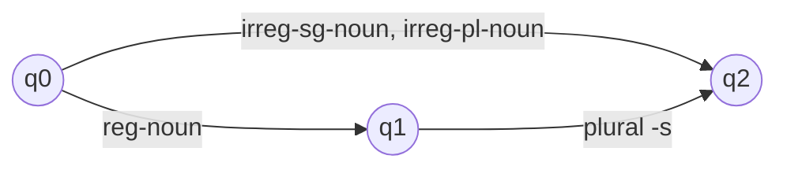
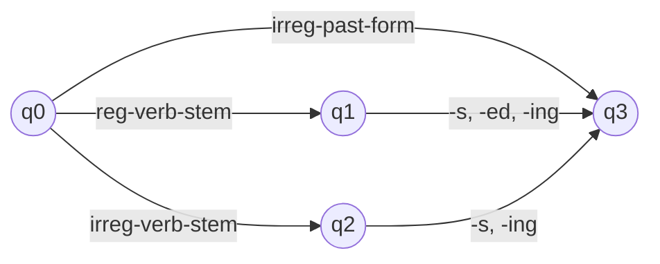
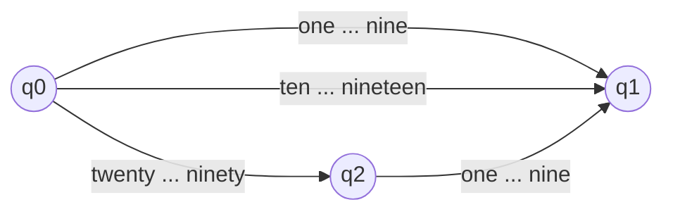

**In simple words:** a finite state automaton (FSA) is a machine with a few states and arrows. It reads a word one piece at a time and moves along the arrows. If it stops in a **final** (accepting) state, the word is valid; otherwise it is rejected. In NLP an FSA checks whether a string is a legal word. <Cite id="morphology-fst-gfg-fa" /> <Cite id="morphology-fst-wiki-fsm" />

**Part 1: FSA for nouns.** A noun is a stem, and a regular noun may take the plural *-s*. Irregular nouns (*mice*, *goose*) are listed whole. <Cite id="morphology-fst-jm-ch3-notes" />

q1 and q2 are final states. It accepts *cat*, *cats*, *goose*, *mice* but rejects *mices* (irregular plural cannot take -s).

**Part 2: FSA for verbs.** A regular verb stem takes -s, -ed, -ing (*walk, walks, walked, walking*); an irregular stem takes only -s and -ing; irregular past forms (*ate*) are listed whole.

q1, q2 and q3 are final. It accepts *walked* and *eating*, rejects *eated*.

**Part 3: FSA for English numbers 1 to 99.** Group the words: **digits** (one to nine), **teens** (ten to nineteen, standing alone) and **tens** (twenty, thirty, ..., ninety). A tens word may be followed by one digit (*twenty-one*).

Final states: q1 and q2. Accepted: *fifteen*, *forty*, *seventy-four*. Rejected: *twenty-ten* (a teen cannot follow a tens word) and *five-six* (q1 has no outgoing arrow).

| Path | Words accepted |
|---|---|
| q0 to q1 by a digit | 9 |
| q0 to q1 by ten to nineteen | 10 |
| q0 to q2 by a tens word (twenty to ninety, 8 words) | 8 |
| q0 to q2 to q1 (8 tens times 9 digits) | 72 |
| Total | 99 |

The total $9 + 10 + 8 + 72 = 99$ matches the 99 numbers from 1 to 99.

**Conclusion:** the same small machine idea checks nouns, verbs and number words, because each is a regular pattern of pieces.
