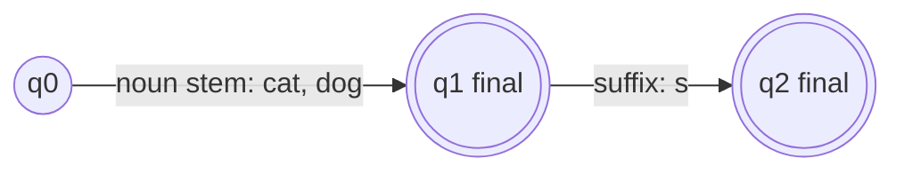
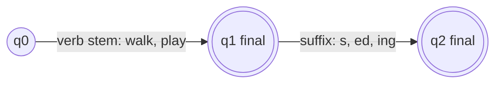
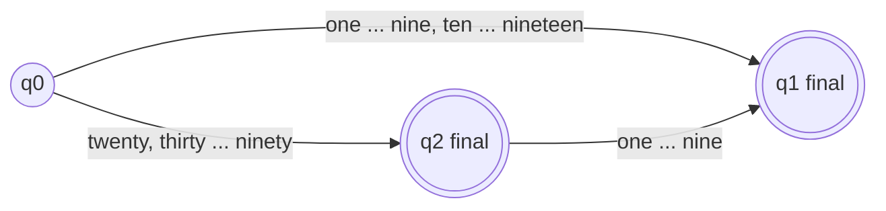

**In simple words:** an FSA for nouns and verbs reads a stem and then an optional ending; an FSA for numbers reads number words in the allowed order.

**FSA in morphology:** states are stages of word formation, transitions are stems and affixes, and the FSA accepts a valid sequence. <Cite id="class-nlp-pyq2" loc="p. 6" /> <Cite id="class-nlp-m2" loc="p. 5" />

**FSA for nouns** (stem plus plural -s). The class FSAs have the same shape: stem, then suffix. <Cite id="class-nlp-m2" loc="p. 5" />

**FSA for verbs** (stem plus -s, -ed or -ing).

Irregular forms (went, mice) are stored in the lexicon, because the ending rule cannot make them. <Cite id="class-nlp-pyq2" loc="p. 9" />

**FSA for the English numbers 1 to 99** (a standard design; the class files do not show it).

| Input | Path | Result |
|---|---|---|
| seven | q0 to q1 | accepted |
| thirteen | q0 to q1 | accepted |
| twenty | q0 to q2 | accepted |
| forty two | q0 to q2 to q1 | accepted |
| twenty thirteen | no arc from q2 on thirteen | rejected |

**Conclusion:** both automata follow the same idea: start state, read the allowed words in order, accept in a final state.
