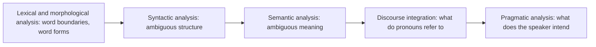

**In simple words:** NLP stages mein kaam karta hai, aur har stage pichle stage ka output use karta hai. Har stage ki apni difficulty hai, aur early stage ki ek galti baad ke saare stages kharab kar deti hai. <Cite id="nlp-introduction-gfg-phases" /> <Cite id="nlp-introduction-slp3" />

**1. Lexical aur morphological analysis (words).**
- *Tokenization:* word kahan khatam hota hai? "New York", "don't", "U.S.A." aur "e-mail" ko todna mushkil hai. Hindi, Chinese aur Thai text mein clear spaces nahi hote.
- *Word forms:* run, ran, running ka ek lemma hai; naye words, slang aur spelling mistakes kisi dictionary mein nahi hote.
- *Lexical ambiguity:* *bank* (paisa ya nadi), *book* (noun ya verb).

**2. Syntactic analysis (grammar).** Ek sentence ke ek se zyada parse trees ho sakte hain: "I saw the man with a telescope." Phrase attachment aur "old men and women" classic cases hain. Real text grammar ke hisaab se galat bhi hota hai (tweets, speech). <Cite id="ambiguity-challenges-tp-ambiguities" />

**3. Semantic analysis (meaning).** Word ka sahi sense chunna padta hai ("He sat on the **bank**"). Idioms ("kick the bucket"), metaphor aur sarcasm word-by-word samajh nahi aate. Scope bhi confuse karta hai: "Every student read a book" (same book ya alag-alag?).

**4. Discourse integration (sentences saath mein).** Sentence pehle ke sentences pe depend karta hai: "Ravi met Amit. **He** was late." mein *he* kaun hai? Pronouns resolve karna aur sentences ke beech ideas jodna mushkil hai.

**5. Pragmatic analysis (intent aur world knowledge).** "Can you pass the salt?" ek request hai, yes/no question nahi. Iske liye common sense chahiye, jo machines ke paas nahi.

**General challenges:** kai languages aur dialects, code-mixing (Hinglish), low-resource languages ke liye kam data, noisy text, aur training data mein bias. <Cite id="ambiguity-challenges-gfg-ambiguity" />

| Stage | Typical challenge | Example |
|---|---|---|
| Lexical | Word boundary, unknown words | "New York" |
| Syntactic | Several parse trees | telescope sentence |
| Semantic | Word sense, idioms | bank |
| Discourse | Pronoun reference | He |
| Pragmatic | Hidden intent | "Can you pass the salt?" |

**Conclusion:** ambiguity har stage pe aati hai, isliye NLP systems ko sahi reading chunne ke liye context, statistics aur world knowledge chahiye.
