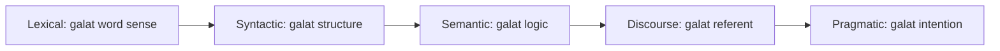

**In simple words:** NLP ke har stage par wahi sentence ek se zyada tareeke se padha ja sakta hai, isliye har stage ka apna challenge hai.

| Stage | Kya karta hai | Challenge | Example |
|---|---|---|---|
| 1. Lexical or morphological | Sentence ko tokens mein baantta hai | Ek word, kai meanings | I saw a bat in a cave: flying mammal ya playing toy |
| 2. Syntactic | Grammatical order check karta hai | Ek sentence, kai structures | She hit the man with an umbrella: weapon, ya aadmi ke paas umbrella tha |
| 3. Semantic | Literal aur dictionary meaning check karta hai | Grammar clear hai par logic kai meanings allow karta hai | Someone ate every slice of pizza |
| 4. Discourse integration | Sentence ko agle se jodta hai | Pronoun ek se zyada nouns ki taraf point kar sakta hai | Mary told Susan that she had won the competition |
| 5. Pragmatic | Intended meaning nikalta hai | Literal meaning clear hai par intent alag hai | My coffee is cold: fact, ya complaint |

<Cite id="class-nlp-m1" loc="p. 1" /> <Cite id="class-nlp-m1" loc="p. 2" /> <Cite id="class-nlp-m1" loc="p. 4" /> <Cite id="class-nlp-m1" loc="p. 5" /> <Cite id="class-nlp-m1" loc="p. 6" /> <Cite id="class-nlp-m1" loc="p. 7" /> <Cite id="class-nlp-m1" loc="p. 8" />

Ambiguity ke alawa, pragmatic stage ko figurative language jaise idioms aur metaphors bhi padhne hote hain. <Cite id="class-nlp-asol" loc="p. 1" />

**Conclusion:** stages words se intention tak jaate hain, aur har stage ka challenge ye hai ki ek se zyada readings possible hain.
