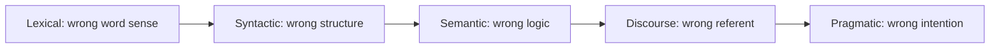

**In simple words:** at every stage of NLP the same sentence can be read in more than one way, so every stage has its own challenge.

| Stage | What it does | Challenge | Example |
|---|---|---|---|
| 1. Lexical or morphological | Divides the sentence into tokens | One word, many meanings | I saw a bat in a cave: flying mammal or a playing toy |
| 2. Syntactic | Checks grammatical order | One sentence, many structures | She hit the man with an umbrella: weapon, or the man carried it |
| 3. Semantic | Checks literal and dictionary meaning | Grammar is clear but the logic allows many meanings | Someone ate every slice of pizza |
| 4. Discourse integration | Links a sentence to the next | A pronoun can point to more than one noun | Mary told Susan that she had won the competition |
| 5. Pragmatic | Finds the intended meaning | The literal meaning is clear but the intent is different | My coffee is cold: a fact, or a complaint |

<Cite id="class-nlp-m1" loc="p. 1" /> <Cite id="class-nlp-m1" loc="p. 2" /> <Cite id="class-nlp-m1" loc="p. 4" /> <Cite id="class-nlp-m1" loc="p. 5" /> <Cite id="class-nlp-m1" loc="p. 6" /> <Cite id="class-nlp-m1" loc="p. 7" /> <Cite id="class-nlp-m1" loc="p. 8" />

Beyond ambiguity, the pragmatic stage also has to read figurative language such as idioms and metaphors. <Cite id="class-nlp-asol" loc="p. 1" />

**Conclusion:** the stages go from words to intention, and the challenge at each stage is that more than one reading is possible.
