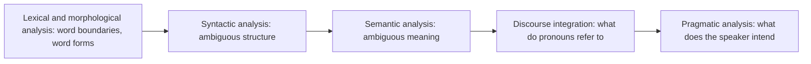

**In simple words:** NLP works in stages, each one using the output of the one before. Every stage has its own difficulty, and a mistake in an early stage spoils all the later ones. <Cite id="nlp-introduction-gfg-phases" /> <Cite id="nlp-introduction-slp3" />

**1. Lexical and morphological analysis (words).**
- *Tokenization:* where does a word end? "New York", "don't", "U.S.A." and "e-mail" are hard to split. Hindi, Chinese and Thai text has no clear spaces.
- *Word forms:* run, ran, running share one lemma; new words, slang and spelling mistakes are not in any dictionary.
- *Lexical ambiguity:* *bank* (money or river), *book* (noun or verb).

**2. Syntactic analysis (grammar).** A sentence can have more than one parse tree: "I saw the man with a telescope." Phrase attachment and "old men and women" are classic cases. Real text is also ungrammatical (tweets, speech). <Cite id="ambiguity-challenges-tp-ambiguities" />

**3. Semantic analysis (meaning).** The right sense of a word must be chosen ("He sat on the **bank**"). Idioms ("kick the bucket"), metaphor and sarcasm cannot be understood word by word. Scope also confuses: "Every student read a book" (the same book or different books?).

**4. Discourse integration (sentences together).** A sentence depends on earlier ones: in "Ravi met Amit. **He** was late." who is *he*? Resolving pronouns and linking ideas across sentences is hard.

**5. Pragmatic analysis (intent and world knowledge).** "Can you pass the salt?" is a request, not a yes/no question. This needs common sense, which machines lack.

**General challenges:** many languages and dialects, code-mixing (Hinglish), little data for low-resource languages, noisy text, and bias in training data. <Cite id="ambiguity-challenges-gfg-ambiguity" />

| Stage | Typical challenge | Example |
|---|---|---|
| Lexical | Word boundary, unknown words | "New York" |
| Syntactic | Several parse trees | telescope sentence |
| Semantic | Word sense, idioms | bank |
| Discourse | Pronoun reference | He |
| Pragmatic | Hidden intent | "Can you pass the salt?" |

**Conclusion:** ambiguity appears at every stage, so NLP systems need context, statistics and world knowledge to choose the right reading.
