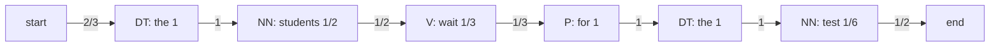

**In simple words:** a bigram HMM tagger uses two kinds of probabilities. The **transition** probability $P(t_i \mid t_{i-1})$ says how likely a tag is after the previous tag. The **emission** probability $P(w \mid t)$ says how likely a tag is to produce a word. Both are found by counting in the tagged corpus. <Cite id="class-nlp-pyq3" loc="p. 7" />

$$
P(t_i \mid t_{i-1}) = \frac{C(t_{i-1}, t_i)}{C(t_{i-1})}, \qquad P(w_i \mid t_i) = \frac{C(t_i, w_i)}{C(t_i)}
$$

**Part 1: probabilities from the corpus.**

<Sum>

<Given>

three tagged sentences, each between $\langle s\rangle$ and $\langle /s\rangle$. Tag sequences: (1) DT NN V DT NN, (2) DT NN V P DT NN, (3) NN V NN. Words: the students pass the test / the students wait for the result / teachers test students.

</Given>

<Find>

all transition and emission probabilities.

</Find>

<Steps>

1. **Tag counts.** $\langle s\rangle = 3$; DT $= 2+2 = 4$; NN $= 2+2+2 = 6$; V $= 3$; P $= 1$. *Reason: count each tag over the three sentences. Total tagged words $4+6+3+1 = 14 = 5+6+3$.*
2. **Transitions.** $\langle s\rangle \to$ DT happens in sentences 1 and 2, so $2/3$; $\langle s\rangle \to$ NN once (sentence 3), so $1/3$. DT is always followed by NN (4 times): $4/4 = 1$. NN is followed by V three times (students-pass, students-wait, teachers-test) and by $\langle /s\rangle$ three times (test, result, students): $3/6 = 1/2$ each. V is followed by DT (pass-the), P (wait-for) and NN (test-students), once each: $1/3$ each. P is followed by DT: $1/1 = 1$.
3. **Emissions.** DT: *the* 4 times, so $4/4 = 1$. NN: *students* 3, *test* 1, *result* 1, *teachers* 1, so $3/6 = 1/2$, and $1/6$ each for the others. V: *pass*, *wait*, *test* once each, $1/3$ each. P: *for*, $1$.

</Steps>

<Answer>

| From | To | Probability |
|---|---|---|
| $\langle s\rangle$ | DT | 2/3 |
| $\langle s\rangle$ | NN | 1/3 |
| DT | NN | 1 |
| NN | V | 1/2 |
| NN | $\langle /s\rangle$ | 1/2 |
| V | DT | 1/3 |
| V | P | 1/3 |
| V | NN | 1/3 |
| P | DT | 1 |

| Tag | Word probabilities |
|---|---|
| DT | the 1 |
| NN | students 1/2, test 1/6, result 1/6, teachers 1/6 |
| V | pass 1/3, wait 1/3, test 1/3 |
| P | for 1 |

</Answer>

<Box kind="verify">

Every row must add to 1: $\langle s\rangle$: $2/3 + 1/3$; NN: $1/2 + 1/2$; V: $3 \times 1/3$; NN emissions: $1/2 + 3 \times 1/6 = 1$; V emissions $3 \times 1/3 = 1$. Also the outgoing transitions of each tag must equal its count: DT 4, NN $3+3 = 6$, V 3, P 1.

</Box>

</Sum>

**Part 2: Viterbi decoding of "The students wait for the test".** Assumption: lowercase the first word. $v_t(j)$ is the best probability of any tag path ending in tag $j$ at word $t$. 

$$
v_t(j) = \max_i \; v_{t-1}(i) \cdot P(j \mid i) \cdot P(w_t \mid j)
$$

<Sum>

<Given>

the tables above; words: the, students, wait, for, the, test.

</Given>

<Find>

the most probable tag sequence and its probability.

</Find>

<Steps>

1. **Which tags can emit each word.** *the*: only DT. *students*: only NN. *wait*: only V. *for*: only P. *test*: NN or V. Other tags have emission 0, so their value is 0.
2. **the:** $v_1(\text{DT}) = P(\text{DT}\mid\langle s\rangle)\,P(\text{the}\mid\text{DT}) = 2/3 \times 1 = 2/3$.
3. **students:** $v_2(\text{NN}) = 2/3 \times 1 \times 1/2 = 1/3$.
4. **wait:** $v_3(\text{V}) = 1/3 \times 1/2 \times 1/3 = 1/18$.
5. **for:** $v_4(\text{P}) = 1/18 \times 1/3 \times 1 = 1/54$.
6. **the:** $v_5(\text{DT}) = 1/54 \times 1 \times 1 = 1/54$.
7. **test:** as NN, $v_6(\text{NN}) = 1/54 \times P(\text{NN}\mid\text{DT}) \times P(\text{test}\mid\text{NN}) = 1/54 \times 1 \times 1/6 = 1/324$. As V, $P(\text{V}\mid\text{DT}) = 0$, so $v_6(\text{V}) = 0$. NN wins.
8. **End:** multiply by $P(\langle /s\rangle \mid \text{NN}) = 1/2$ to get $1/648$. *Reason: the sentence must end after the last tag.*

</Steps>

<Answer>

The/DT students/NN wait/V for/P the/DT test/NN. Probability $= 1/648 \approx 1.54 \times 10^{-3}$ (or $1/324 \approx 3.09 \times 10^{-3}$ without the end symbol).

</Answer>

<Box kind="verify">

Multiply all thirteen factors in one line: $\tfrac23 \cdot 1 \cdot 1 \cdot \tfrac12 \cdot \tfrac12 \cdot \tfrac13 \cdot \tfrac13 \cdot 1 \cdot 1 \cdot 1 \cdot 1 \cdot \tfrac16 \cdot \tfrac12$. Numerator $= 2$; denominator $= 3 \cdot 2 \cdot 2 \cdot 3 \cdot 3 \cdot 6 \cdot 2 = 1296$. So $2/1296 = 1/648$, the same. Each word but the last has only one possible tag, and the V option for *test* has probability 0, so there is only one path with non-zero probability.

</Box>

</Sum>

| Word | DT | NN | V | P |
|---|---|---|---|---|
| the | 0.6667 | 0 | 0 | 0 |
| students | 0 | 0.3333 | 0 | 0 |
| wait | 0 | 0 | 0.05556 | 0 |
| for | 0 | 0 | 0 | 0.01852 |
| the | 0.01852 | 0 | 0 | 0 |
| test | 0 | 0.003086 | 0 | 0 |

**Conclusion:** counting gives the HMM tables, and Viterbi picks the best tag path: DT NN V P DT NN.
