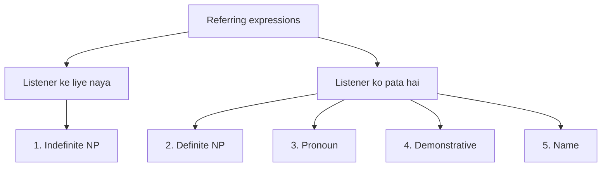

**In simple words:** referring expression wo phrase hai jo kisi insaan, object ya idea ko point karta hai. Class mein **paanch types** hain: indefinite noun phrases, definite noun phrases, pronouns, demonstratives aur names. <Cite id="class-nlp-asol" loc="p. 4" />

**Referring expressions** speaker aur listener ko batate hain ki kisi context mein kis cheez ya kis insaan ki baat ho rahi hai.

1. **Indefinite noun phrase:** listener ke liye nayi ya pehle mention na hui cheez ko refer karta hai; naya information laata hai aur aam taur pe a, an ya some hota hai. *Example:* "Ram had gone around one day to bring him **some food**." <Cite id="class-nlp-asol" loc="p. 4" />
2. **Definite noun phrase:** indefinite ka ulta; pehle se known, specific ya identifiable cheez ko refer karta hai, aam taur pe the hota hai. *Example:* "I used to read **The Times of India**." <Cite id="class-nlp-asol" loc="p. 5" />
3. **Pronoun:** noun ki jagah use hone wala word, repetition bachane ke liye. Ye pehle mention hue noun ko refer karta hai, isliye definite reference hai. *Example:* "Ram laughed as loud as **he** could." Yahan *he* matlab Ram.
4. **Demonstrative:** words jo specific cheezon ko point karte hain aur speaker se doori dikhate hain: this, that, these, those. *Examples:* "**This** is my book." (paas) "**That** is your car." (door)
5. **Name:** sabse simple aur direct form; kisi specific person, place, organization ya cheez ko identify karta hai aur context nahi chahiye. *Example:* "**Ram** laughed as loud as he could." India, Microsoft, Taj Mahal bhi. <Cite id="class-nlp-asol" loc="p. 5" /> <Cite id="class-nlp-asol" loc="p. 6" />

| Type | Key word | Example |
|---|---|---|
| Indefinite NP | a, an, some | some food |
| Definite NP | the | The Times of India |
| Pronoun | he, she, it | he |
| Demonstrative | this, that | This is my book |
| Name | proper name | Ram |

**Conclusion:** pehla type baat mein nayi cheezein laata hai; baaki chaar un cheezon ko point karte hain jo listener pehle se pehchaan sakta hai.
