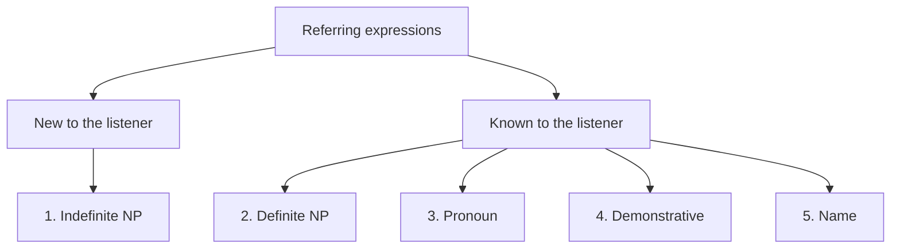

**In simple words:** a referring expression is a phrase used to point to a person, object or idea. The class names **five types**: indefinite noun phrases, definite noun phrases, pronouns, demonstratives and names. <Cite id="class-nlp-asol" loc="p. 4" />

**Referring expressions** help the speaker and listener identify what or who is being talked about in a particular context.

1. **Indefinite noun phrase:** refers to something new to the listener or not mentioned before; it introduces new information and usually contains a, an or some. *Example:* "Ram had gone around one day to bring him **some food**." <Cite id="class-nlp-asol" loc="p. 4" />
2. **Definite noun phrase:** the opposite of indefinite; it refers to something already known, specific or identifiable, and usually contains the. *Example:* "I used to read **The Times of India**." <Cite id="class-nlp-asol" loc="p. 5" />
3. **Pronoun:** a word used instead of a noun to avoid repetition. It refers back to a noun already mentioned, so it is a definite reference. *Example:* "Ram laughed as loud as **he** could." Here *he* is Ram.
4. **Demonstrative:** words that point to specific entities and show distance from the speaker: this, that, these, those. *Examples:* "**This** is my book." (near) "**That** is your car." (far)
5. **Name:** the simplest and most direct form; it identifies a specific person, place, organization or thing and needs no context. *Example:* "**Ram** laughed as loud as he could." Also India, Microsoft, Taj Mahal. <Cite id="class-nlp-asol" loc="p. 5" /> <Cite id="class-nlp-asol" loc="p. 6" />

| Type | Key word | Example |
|---|---|---|
| Indefinite NP | a, an, some | some food |
| Definite NP | the | The Times of India |
| Pronoun | he, she, it | he |
| Demonstrative | this, that | This is my book |
| Name | proper name | Ram |

**Conclusion:** the first type brings new things into the talk; the other four point to things the listener can already identify.
