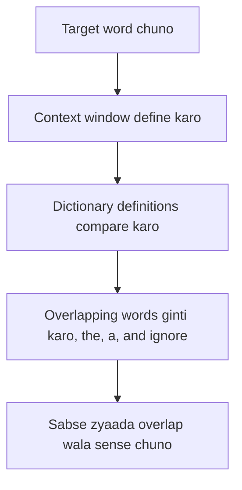

**In simple words:** Lesk's algorithm word ki meaning aise chunta hai: dekhta hai ki kaunsi dictionary definition aas-paas ke words ke saath sabse zyaada words share karti hai. <Cite id="class-nlp-pyq4" loc="p. 3" />

**Definition:** Lesk's algorithm word sense disambiguation (WSD) ka dictionary-based approach hai, yaani ye pata karna ki word ka kaunsa sense (meaning) diye gaye context mein use hua hai. Ise seminal maana jaata hai aur Michael E. Lesk ne ise 1986 mein introduce kiya. <Cite id="class-nlp-pyq4" loc="p. 3" />

**Idea:** text mein saath use hue words ek doosre se related hote hain, aur ye relation words aur unki meanings ki definitions mein dikhta hai. Algorithm maanta hai ki ek neighbourhood (text ke ek hisse) ke words ka theme similar hota hai. <Cite id="class-nlp-pyq4" loc="p. 3" />

**Basic Lesk algorithm ke steps** <Cite id="class-nlp-pyq4" loc="p. 3" />

1. **Select word:** wo word chuno jiski meaning chahiye, target word.
2. **Define context window:** target word ke aas-paas ke words ka ek group pehchano.
3. **Compare definitions:** target word ki dictionary definitions ko context window ke words ki definitions se compare karo.
4. **Count overlaps:** dono mein common words ginti karo. "the", "a", "and" jaise common words hata do.
5. **Choose most overlapping definition:** target word ki wo definition chuno jiska overlap count sabse zyaada ho. Wahi current context mein sabse likely meaning hai.

<Sum>

<Given>

sentence "I deposited money in the bank", aur *bank* ke do dictionary senses: sense 1 "an institution that keeps money and gives loans"; sense 2 "the land at the side of a river". (Ye chhoti definitions example ke liye banayi gayi hain.)

</Given>

<Find>

Lesk's algorithm ne *bank* ka kaunsa sense chuna.

</Find>

<Steps>

1. Target word: *bank*. Context window: *deposited*, *money*.
2. Definitions se common words hatao (an, the, of, at, that, and, in).
3. Sense 1 mein bachte hain: institution, keeps, money, gives, loans. Context ke saath overlap = word *money*, yaani 1.
4. Sense 2 mein bachte hain: land, side, river. Context ke saath overlap = 0.
5. Sabse zyaada overlap 1 hai, sense 1 ka.

</Steps>

<Answer>

*bank* = financial institution (sense 1).

</Answer>

<Box kind="verify">

Doosra sentence try karo "The fisherman sat on the river bank". Context: *fisherman*, *sat*, *river*. Sense 1 overlap = 0; sense 2 overlap = word *river*, yaani 1, isliye wo nadi ke kinare wala sense chunta hai, jo sahi hai. Alag context par method alag answer deta hai.

</Box>

</Sum>

**Advantages** <Cite id="class-nlp-pyq4" loc="p. 3" />

1. Implement karna simple: samajhna aasaan, kuch lines ka code.
2. Bina bade badlav ke alag-alag contexts par lagu.
3. Naye words par unki dictionary definitions se aasani se generalize hota hai.
4. Non-syntactic: words ki grammatical arrangement par depend nahi karta.
5. Jab word ke senses saaf alag hon to achhi accuracy.

**Disadvantages** <Cite id="class-nlp-pyq4" loc="p. 3" /> <Cite id="class-nlp-pyq4" loc="p. 4" />

1. Jab word ke kai semantically similar senses hon to accuracy kam.
2. Low recall: definitions aur context ke beech overlap bahut kam ho to fail ho sakta hai.
3. Dictionary dependent: results dictionary ki quality aur completeness par depend karte hain.

**Conclusion:** Lesk's algorithm wo sense chunta hai jiski dictionary definition context ke saath sabse zyaada overlap karti hai.
