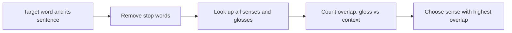

**In simple words:** bahut se words ke kai meanings (senses) hote hain. **Word sense disambiguation (WSD)** sentence ke liye sahi meaning chunta hai. **Lesk algorithm** (Lesk, 1986) dictionary-based method hai: wo sense chuno jiski dictionary **definition (gloss)** target ke aas-paas ke words se sabse zyada words share kare. <Cite id="word-sense-disambiguation-wiki-lesk" /> <Cite id="word-sense-disambiguation-gfg-wsd" />

**Idea:** ek sentence ke words ek hi topic ke hote hain, isliye sahi sense ke gloss mein wahi baatein honi chahiye jo context mein hain. Lesk ka apna example *pine cone* hai: *pine* ke gloss ("kinds of evergreen tree with needle-shaped leaves") aur *cone* ke gloss ("fruit of certain evergreen trees") mein *evergreen tree* common hai, isliye dono tree wale senses samjhe jaate hain.

**Steps (simplified Lesk):**

1. Target word lo aur WordNet jaisi dictionary se uske senses ki list banao.
2. Context words (sentence) nikalo aur stop words hata do.
3. Har sense ke liye gloss aur context ke common words gino (uska **overlap**).
4. Sabse zyada overlap wala sense chuno; tie ho to most frequent sense lo. <Cite id="word-sense-disambiguation-nltk-wsd" />

<Sum>

<Given>

sentence: "He opened an account and deposited money at the bank." Simplified glosses (is example ke liye likhe gaye): **bank-1** = "financial institution that accepts deposits, keeps your account and lends money"; **bank-2** = "sloping land beside a body of water".

</Given>

<Find>

*bank* ka sahi sense.

</Find>

<Steps>

1. **Context words** stop words (he, an, and, at, the) hatane ke baad: opened, account, deposited, money.
2. **Gloss 1 ke content words:** financial, institution, accepts, deposits, keeps, account, lends, money. Context ke saath common: *account*, *money*, to overlap $= 2$. (*deposits* aur *deposited* stemming ke bina alag hain; stemming se 3 hota.)
3. **Gloss 2 ke content words:** sloping, land, beside, body, water. Context ke saath common: koi nahi, to overlap $= 0$.
4. **Compare:** $2 > 0$, isliye bank-1 chuno.

</Steps>

<Answer>

*bank* ka matlab financial institution (bank-1), overlap 2 against 0.

</Answer>

<Box kind="verify">

Har context word ko dono glosses se milao: opened (kisi mein nahi), account (gloss 1), deposited (kisi mein nahi, exact match), money (gloss 1). Gloss 1 ko 2, gloss 2 ko 0, aur meaning common sense se match karta hai.

</Box>

</Sum>

**Limitations:** result chhote glosses pe depend karta hai, isliye overlap aksar 0 ya 1 hota hai; related words match nahi hote (*deposit* aur *cash*). Extended Lesk related WordNet senses ke glosses bhi jodta hai. **Conclusion:** Lesk ko training data nahi, sirf dictionary chahiye, aur wo sense chunta hai jiski definition context se best match kare.
