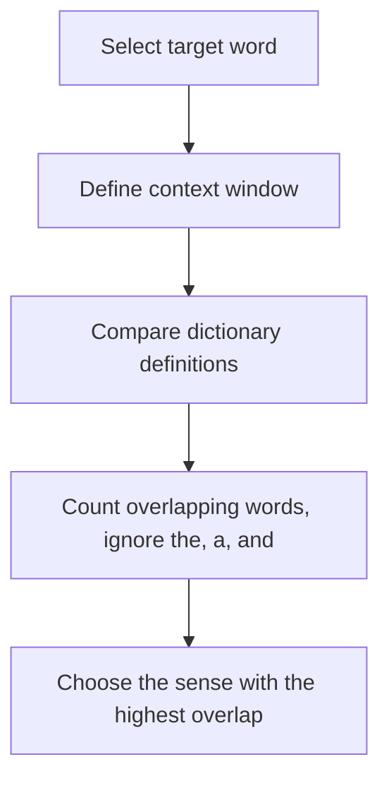

**In simple words:** Lesk's algorithm picks the meaning of a word by looking at which dictionary definition shares the most words with the words around it. <Cite id="class-nlp-pyq4" loc="p. 3" />

**Definition:** Lesk's algorithm is a dictionary-based approach to word sense disambiguation (WSD), the task of finding which sense (meaning) of a word is used in a given context. It is considered seminal and was introduced by Michael E. Lesk in 1986. <Cite id="class-nlp-pyq4" loc="p. 3" />

**Idea:** words used together in a text are related, and this relation can be seen in the definitions of the words and their meanings. The algorithm assumes that words in a given neighbourhood (a portion of text) have a similar theme. <Cite id="class-nlp-pyq4" loc="p. 3" />

**Steps of the basic Lesk algorithm** <Cite id="class-nlp-pyq4" loc="p. 3" />

1. **Select word:** choose the word whose meaning you want, the target word.
2. **Define context window:** identify a group of nearby words around the target word.
3. **Compare definitions:** compare the dictionary definitions of the target word with the definitions of the words in the context window.
4. **Count overlaps:** count the words that appear in both. Exclude common words like "the", "a" and "and".
5. **Choose the most overlapping definition:** select the definition of the target word with the highest overlap count. This is the most likely meaning in the current context.

<Sum>

<Given>

the sentence "I deposited money in the bank", and two dictionary senses of *bank*: sense 1 "an institution that keeps money and gives loans"; sense 2 "the land at the side of a river". (These short definitions are made up for the example.)

</Given>

<Find>

the sense of *bank* chosen by Lesk's algorithm.

</Find>

<Steps>

1. Target word: *bank*. Context window: *deposited*, *money*.
2. Remove common words from the definitions (an, the, of, at, that, and, in).
3. Sense 1 keeps: institution, keeps, money, gives, loans. Overlap with the context = the word *money*, so 1.
4. Sense 2 keeps: land, side, river. Overlap with the context = 0.
5. The highest overlap is 1, for sense 1.

</Steps>

<Answer>

*bank* = financial institution (sense 1).

</Answer>

<Box kind="verify">

Try the other sentence "The fisherman sat on the river bank". Context: *fisherman*, *sat*, *river*. Sense 1 overlap = 0; sense 2 overlap = the word *river*, so 1, so it picks the land beside the river, which is right. The method gives different answers for different contexts.

</Box>

</Sum>

**Advantages** <Cite id="class-nlp-pyq4" loc="p. 3" />

1. Simple to implement: easy to understand, a few lines of code.
2. Applicable to different contexts without major modifications.
3. Easily generalizable to new words using their dictionary definitions.
4. Non-syntactic: does not depend on the grammatical arrangement of the words.
5. Good accuracy when the senses of a word are clearly distinguishable.

**Disadvantages** <Cite id="class-nlp-pyq4" loc="p. 3" /> <Cite id="class-nlp-pyq4" loc="p. 4" />

1. Low accuracy when a word has several semantically similar senses.
2. Low recall: it may fail when there is too little overlap between the definitions and the context.
3. Dictionary dependent: results depend on the quality and completeness of the dictionary.

**Conclusion:** Lesk's algorithm chooses the sense whose dictionary definition overlaps most with the context.
