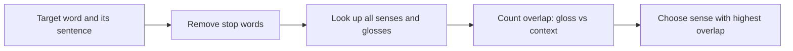

**In simple words:** many words have several meanings (senses). **Word sense disambiguation (WSD)** picks the right one for the sentence. The **Lesk algorithm** (Lesk, 1986) is a dictionary-based method: choose the sense whose dictionary **definition (gloss)** shares the most words with the words around the target. <Cite id="word-sense-disambiguation-wiki-lesk" /> <Cite id="word-sense-disambiguation-gfg-wsd" />

**Idea:** words used together in one sentence are about the same topic, so the right sense should have a gloss that talks about the same things as the context. Lesk's own example is *pine cone*: the gloss of *pine* ("kinds of evergreen tree with needle-shaped leaves") and the gloss of *cone* ("fruit of certain evergreen trees") share the word *evergreen tree*, so both are read as the tree senses.

**Steps (simplified Lesk):**

1. Take the target word and list its senses from a dictionary such as WordNet.
2. Collect the context words (the sentence) and remove stop words.
3. For each sense, count the words shared by its gloss and the context (its **overlap**).
4. Choose the sense with the highest overlap; if tied, take the most frequent sense. <Cite id="word-sense-disambiguation-nltk-wsd" />

<Sum>

<Given>

sentence: "He opened an account and deposited money at the bank." Simplified glosses (written for this example): **bank-1** = "financial institution that accepts deposits, keeps your account and lends money"; **bank-2** = "sloping land beside a body of water".

</Given>

<Find>

the correct sense of *bank*.

</Find>

<Steps>

1. **Context words** after removing stop words (he, an, and, at, the): opened, account, deposited, money.
2. **Gloss 1 content words:** financial, institution, accepts, deposits, keeps, account, lends, money. Shared with context: *account*, *money*, so overlap $= 2$. (*deposits* and *deposited* differ unless we stem; stemming would give 3.)
3. **Gloss 2 content words:** sloping, land, beside, body, water. Shared with context: none, so overlap $= 0$.
4. **Compare:** $2 > 0$, so choose bank-1.

</Steps>

<Answer>

*bank* means the financial institution (bank-1), overlap 2 against 0.

</Answer>

<Box kind="verify">

Check each context word against both glosses: opened (neither), account (gloss 1), deposited (neither, exact match), money (gloss 1). Gloss 1 gets 2, gloss 2 gets 0, and the meaning agrees with common sense.

</Box>

</Sum>

**Limitations:** results depend on short glosses, so overlap is often 0 or 1; related words are not matched (*deposit* and *cash*). Extended Lesk adds glosses of related WordNet senses. **Conclusion:** Lesk needs no training data, only a dictionary, and picks the sense whose definition best matches the context.
