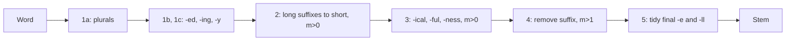

**In simple words:** **stemmer** words ke endings kaat deta hai taaki *connect, connected, connecting, connection* sab ek stem, *connect*, ban jayen. **Porter stemmer** (M. F. Porter, 1980) ye suffix-stripping rules ki fixed list se karta hai, jo paanch ordered steps mein lagti hai. Ye dictionary use nahi karta, aur stem real word hona zaroori nahi (*happy* ka *happi* ban jata hai). <Cite id="porter-stemmer-def" /> <Cite id="porter-stemmer-gfg-stemming" />

**Ye kyun zaroori hai:** search engines aur text classifiers chahte hain ki related word forms ek hi word ginein, isse vocabulary chhoti hoti hai aur recall badhta hai.

**Basic idea: measure $m$.** Word ko `[C](VC)^m[V]` ki tarah likho, jahan C consonants ka run aur V vowels ka run hai (Porter ke rule mein consonant ke baad *y* vowel gina jata hai). $m$ VC pairs ginta hai aur batata hai stem kitna lamba hai. Rule tabhi lagta hai jab kaatne ke baad bacha stem kaafi lamba ho.

| $m$ | Examples |
|---|---|
| 0 | tr, ee, tree, by |
| 1 | trouble, oats, trees, ivy |
| 2 | troubles, private, oaten, orrery |

Conditions: `*v*` (stem mein vowel hai), `*d` (double consonant pe khatam), `*o` (consonant-vowel-consonant pe khatam, last w, x ya y nahi).

**Steps aur sample rules:**

| Step | Job | Sample rules | Example |
|---|---|---|---|
| 1a | plurals | SSES to SS; IES to I; S removed | caresses to caress; ponies to poni |
| 1b | -ed, -ing (stem mein vowel chahiye) | ED, ING removed; phir AT to ATE, ya double letters theek | motoring to motor; hopping to hop; filing to file |
| 1c | y to i (stem mein vowel) | Y to I | happy to happi |
| 2 | double suffixes, $m>0$ | ATIONAL to ATE; IZATION to IZE; FULNESS to FUL | relational to relate |
| 3 | $m>0$ | ALIZE to AL; FUL, NESS removed; ICATE to IC | hopeful to hope |
| 4 | suffix hatao, $m>1$ | AL, ANCE, ER, IC, ABLE, MENT, ION, ISM, ATE, IVE, IZE removed | general to gener |
| 5 | final e agar $m>1$ (ya $m=1$ aur `*o` nahi); -ll to -l agar $m>1$ | E removed | relate to relat |

<Sum>

<Given>

words *generalizations* aur *hopefulness*.

</Given>

<Find>

unke Porter stems, step by step.

</Find>

<Steps>

1. ***generalizations*, step 1a:** S pe khatam, to hata do: *generalization*.
2. **Step 2:** IZATION to IZE, stem *general* ka $m = 3 > 0$: *generalize*.
3. **Step 3:** ALIZE to AL, stem *gener* ka $m = 2 > 0$: *general*.
4. **Step 4:** AL hata, stem *gener* ka $m = 2 > 1$: *gener*. Step 5 ko kuch nahi karna.
5. ***hopefulness*, step 1a:** SS pe khatam, jo SS hi rehta hai. Steps 1b aur 1c nahi lagte.
6. **Step 2:** FULNESS to FUL, stem *hope* ka $m = 1 > 0$: *hopeful*.
7. **Step 3:** FUL hata, stem *hope* ka $m = 1 > 0$: *hope*.
8. **Step 5a:** stem *hop* ka $m = 1$ aur consonant-vowel-consonant (`*o`) pe khatam, isliye final E rehta hai: *hope*.

</Steps>

<Answer>

*generalizations* ka *gener*; *hopefulness* ka *hope*.

</Answer>

<Box kind="verify">

NLTK ka original Porter algorithm <Cite id="porter-stemmer-nltk-stem" /> in dono words ke liye *gener* aur *hope* deta hai. Measure check: *gener* = g-e-n-e-r yani C V C V C, to (VC)(VC) aur $m = 2$.

</Box>

</Sum>

**Advantages:** fast, simple, dictionary nahi chahiye, bahut use hota hai. **Disadvantages:** over-stemming (*university* aur *universe* dono *univers* ban jaate hain), under-stemming, aur stems non-words hote hain. Iski jagah lemmatization ya Snowball stemmer use ho sakta hai.

**Conclusion:** Porter ka stemmer paanch rule steps mein suffix kaat-ta hai, measure $m$ ki guard ke saath, taaki related words ek stem mein aa jayein.
