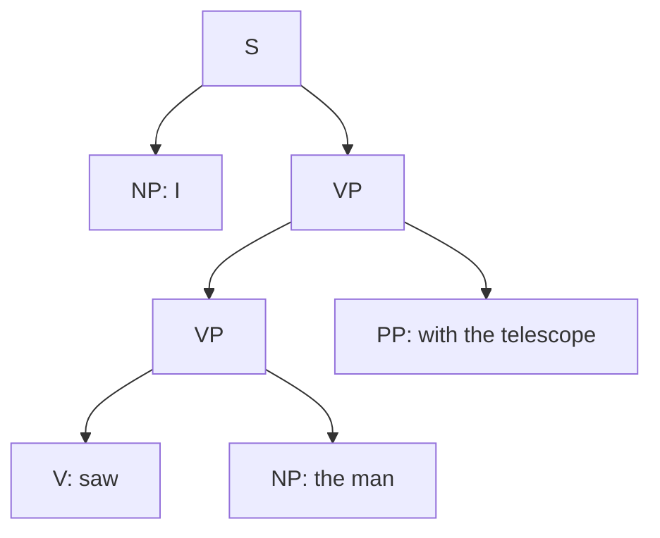
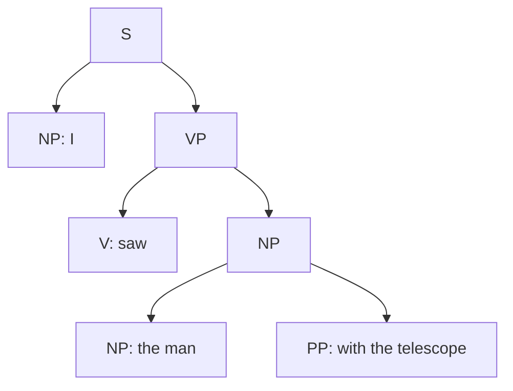

**In simple words:** context-free grammar (CFG) un rules ki list hai jo sentence banate hain, jaise $S \to NP\ VP$. **Probabilistic CFG (PCFG)** har rule ko ek probability deta hai. Ek hi left side wale saare rules ki probabilities ka sum 1 hota hai. Parse tree ki probability uske rules ki probabilities ka **product** hai. <Cite id="cfg-parsing-slp3-E" /> <Cite id="cfg-parsing-wiki-pcfg" />

**Ye kyun zaroori hai:** CFG ek sentence ke kai parse trees de sakta hai ("I saw the man with the telescope") <Cite id="cfg-parsing-tp-syn" /> aur nahi bata sakta ki kaun sa behtar hai. PCFG unhe rank karta hai aur parser sabse probable tree chunta hai.

**NLP mein uses:** (1) **disambiguation** (best parse chuno); (2) **language modelling** (sentence ki probability = uske trees ka sum); (3) **speech recognition aur machine translation**, taaki grammatical output prefer ho; (4) rule probabilities **treebank** mein rules gin ke seekhi jaati hain: $P(A \to \beta) = \dfrac{C(A \to \beta)}{C(A)}$. <Cite id="cfg-parsing-slp3-E" />

<Sum>

<Given>

PCFG: S to NP VP 1.0. VP to V NP 0.6 | VP PP 0.4. NP to Det N 0.5 | NP PP 0.2 | Pro 0.3. PP to P NP 1.0. Pro to I 1.0. V to saw 1.0. Det to the 1.0. N to man 0.6 | telescope 0.4. P to with 1.0. Sentence: "I saw the man with the telescope".

</Given>

<Find>

dono parse trees ki probability aur behtar tree.

</Find>

<Steps>

1. **Tree A (telescope se dekha).** Probability-1 wale rules ke alawa: S to NP VP (1.0); NP to Pro (0.3); VP to VP PP (0.4); VP to V NP (0.6); NP to Det N (0.5) *the man* ke liye, N to man (0.6); NP to Det N (0.5) *the telescope* ke liye, N to telescope (0.4).
2. **A ka product:** $0.3 \times 0.4 \times 0.6 \times 0.5 \times 0.6 \times 0.5 \times 0.4 = 0.00432$.
3. **Tree B (man ke paas telescope hai).** Rules: S to NP VP (1.0); NP to Pro (0.3); VP to V NP (0.6); NP to NP PP (0.2); inner NP to Det N (0.5), man (0.6); NP to Det N (0.5), telescope (0.4).
4. **B ka product:** $0.3 \times 0.6 \times 0.2 \times 0.5 \times 0.6 \times 0.5 \times 0.4 = 0.00216$.
5. **Compare:** $0.00432 > 0.00216$, isliye tree A jeet gaya.

</Steps>

<Answer>

$P(A) = 0.00432$, $P(B) = 0.00216$; parser tree A chunta hai. Sentence ki probability $0.00432 + 0.00216 = 0.00648$.

</Answer>

<Box kind="verify">

Dono trees mein attachment ke alawa saare factors same hain: A mein $0.4 \times 0.6 = 0.24$, B mein $0.6 \times 0.2 = 0.12$. To A exactly B ka double hona chahiye, aur $0.00432 / 0.00216 = 2$. Har rule group ka sum bhi 1 hai: VP $0.6 + 0.4$, NP $0.5 + 0.2 + 0.3$, N $0.6 + 0.4$.

</Box>

</Sum>

**Limits:** independence assumption context ko ignore karta hai (rule ki probability words pe depend nahi karti, isliye "ate pizza with a fork" aur "with anchovies" ek jaise dikhte hain) aur treebank chahiye. **Conclusion:** PCFG, CFG mein probabilities jodta hai taaki parser sabse likely tree chun sake.
