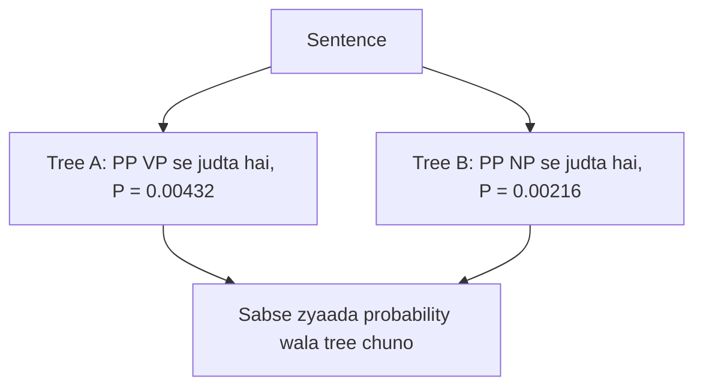

**In simple words:** PCFG ek context-free grammar hai jisme har rule ki ek probability bhi hoti hai. Jab ek sentence ke ek se zyaada parse trees hon, to probabilities batati hain ki sabse likely tree kaunsa hai.

*(Class files mein PCFG nahi hai; ye standard short answer hai.)*

**Definition:** Probabilistic Context-Free Grammar (PCFG) ek CFG hai jisme har rule $A \to \beta$ ke saath probability hoti hai, aur ek hi left side wale saare rules ki probabilities ka sum 1 hota hai. Parse tree ki probability use hue rules ki probabilities ka product hoti hai.

**Ye kyun zaroori hai:** plain CFG ek sentence ke kai parse trees de sakti hai (ambiguity, jaise "I saw the man with the telescope", jise class syntactic ambiguity ke example ke roop mein bhi use karti hai <Cite id="class-nlp-pyq4" loc="p. 6" />) aur ye nahi bata sakti ki kaunsa behtar hai. PCFG trees ko rank karti hai.

<Sum>

<Given>

probabilities wale rules: S → NP VP [1.0]; NP → Det N [0.6] | NP PP [0.2] | I [0.2]; VP → V NP [0.6] | VP PP [0.4]; PP → P NP [1.0]; Det → the [1.0]; N → man [0.5] | telescope [0.5]; V → saw [1.0]; P → with [1.0]. Sentence: *I saw the man with the telescope*.

</Given>

<Find>

har parse tree ki probability aur behtar tree.

</Find>

<Steps>

1. **Tree A (PP verb phrase ka hissa hai: maine telescope use kiya).** Rules: S → NP VP (1.0), NP → I (0.2), VP → VP PP (0.4), VP → V NP (0.6), V → saw (1), NP → Det N (0.6), Det → the (1), N → man (0.5), PP → P NP (1), P → with (1), NP → Det N (0.6), Det → the (1), N → telescope (0.5).
   $P(A) = 1 \times 0.2 \times 0.4 \times 0.6 \times 0.6 \times 0.5 \times 0.6 \times 0.5 = 0.00432$.
2. **Tree B (PP noun phrase ka hissa hai: aadmi ke paas telescope hai).** Rules: S → NP VP (1.0), NP → I (0.2), VP → V NP (0.6), V → saw (1), NP → NP PP (0.2), NP → Det N (0.6), N → man (0.5), PP → P NP (1), NP → Det N (0.6), N → telescope (0.5).
   $P(B) = 1 \times 0.2 \times 0.6 \times 0.2 \times 0.6 \times 0.5 \times 0.6 \times 0.5 = 0.00216$.
3. Compare: $0.00432 > 0.00216$.

</Steps>

<Answer>

Tree A zyaada probable parse hai, probability $0.00432$ (tree B ke $0.00216$ ka double).

</Answer>

<Box kind="verify">

Same left side wale rules ki probabilities ka sum 1 hai: NP $0.6 + 0.2 + 0.2 = 1$; VP $0.6 + 0.4 = 1$; N $0.5 + 0.5 = 1$. Dono trees sirf itne alag hain: A mein VP → VP PP (0.4) aur VP → V NP (0.6), B mein NP → NP PP (0.2) aur VP → V NP (0.6), isliye A, B ka $0.4 / 0.2 = 2$ guna hai, jaisa mila.

</Box>

</Sum>

**Uses:** ambiguity resolve karke parsing, speech recognition, machine translation. **Limitation:** rule probabilities asli words ko ignore karti hain, aur probabilities treebank se seekhni padti hain.

**Conclusion:** PCFG CFG rules mein probabilities jodti hai taaki sabse probable parse chuna ja sake.
