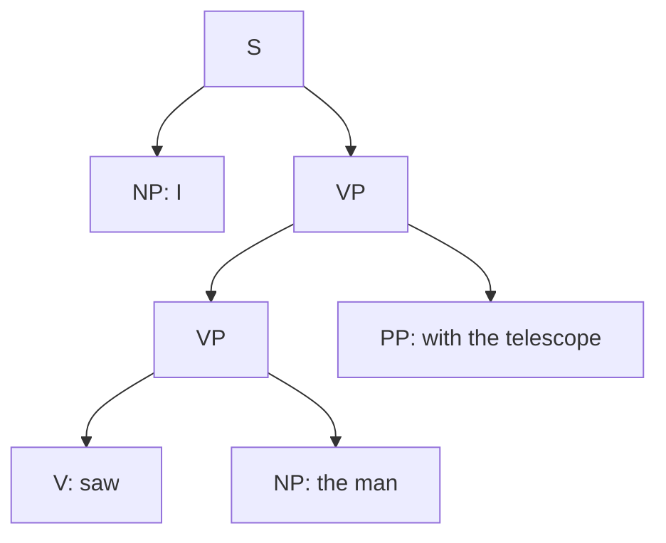
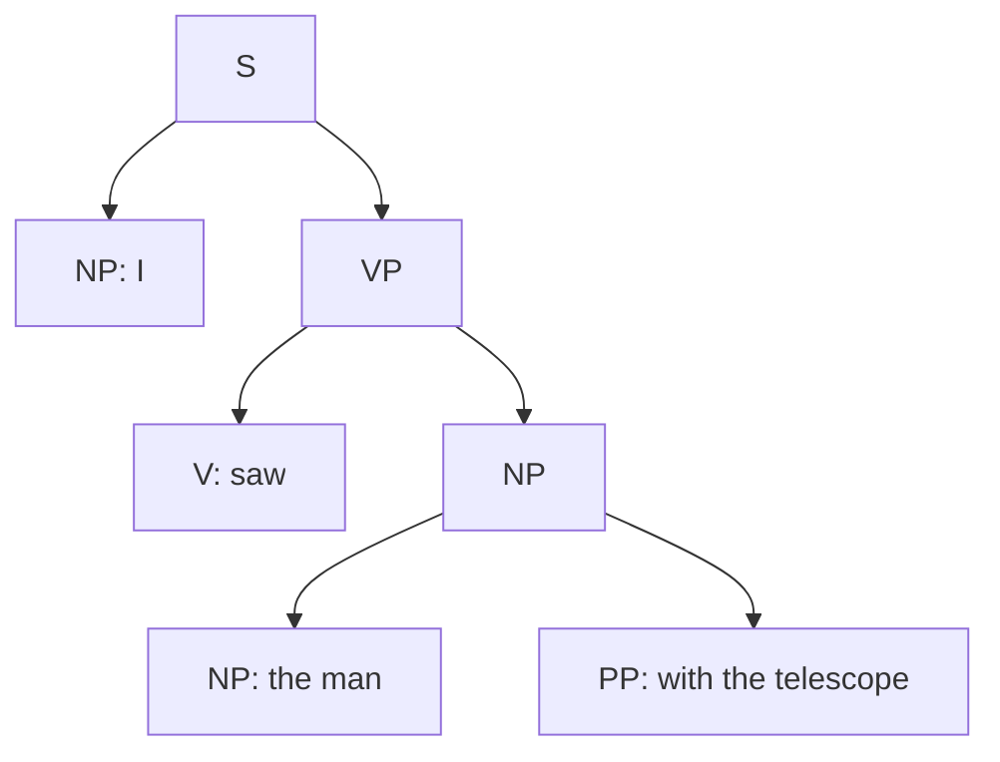

**In simple words:** a context-free grammar (CFG) lists the rules that build a sentence, such as $S \to NP\ VP$. A **probabilistic CFG (PCFG)** gives every rule a probability. The probabilities of all rules with the same left side add up to 1. A parse tree's probability is the **product** of the probabilities of the rules it uses. <Cite id="cfg-parsing-slp3-E" /> <Cite id="cfg-parsing-wiki-pcfg" />

**Why it is needed:** a CFG can give many parse trees for one sentence ("I saw the man with the telescope") <Cite id="cfg-parsing-tp-syn" /> and cannot say which is better. A PCFG ranks them and the parser picks the most probable tree.

**Uses in NLP:** (1) **disambiguation** (choose the best parse); (2) **language modelling** (probability of a sentence = sum over its trees); (3) **speech recognition and machine translation**, to prefer grammatical output; (4) rule probabilities are learned by counting rules in a **treebank**: $P(A \to \beta) = \dfrac{C(A \to \beta)}{C(A)}$. <Cite id="cfg-parsing-slp3-E" />

<Sum>

<Given>

PCFG: S to NP VP 1.0. VP to V NP 0.6 | VP PP 0.4. NP to Det N 0.5 | NP PP 0.2 | Pro 0.3. PP to P NP 1.0. Pro to I 1.0. V to saw 1.0. Det to the 1.0. N to man 0.6 | telescope 0.4. P to with 1.0. Sentence: "I saw the man with the telescope".

</Given>

<Find>

the probability of each of the two parse trees and the better one.

</Find>

<Steps>

1. **Tree A (the telescope is the tool of seeing).** Rules used besides the probability-1 ones: S to NP VP (1.0); NP to Pro (0.3); VP to VP PP (0.4); VP to V NP (0.6); NP to Det N (0.5) for *the man* with N to man (0.6); NP to Det N (0.5) for *the telescope* with N to telescope (0.4).
2. **Multiply for A:** $0.3 \times 0.4 \times 0.6 \times 0.5 \times 0.6 \times 0.5 \times 0.4 = 0.00432$.
3. **Tree B (the man has the telescope).** Rules: S to NP VP (1.0); NP to Pro (0.3); VP to V NP (0.6); NP to NP PP (0.2); inner NP to Det N (0.5) with man (0.6); NP to Det N (0.5) with telescope (0.4).
4. **Multiply for B:** $0.3 \times 0.6 \times 0.2 \times 0.5 \times 0.6 \times 0.5 \times 0.4 = 0.00216$.
5. **Compare:** $0.00432 > 0.00216$, so tree A wins.

</Steps>

<Answer>

$P(A) = 0.00432$, $P(B) = 0.00216$; the parser chooses tree A. The sentence probability is $0.00432 + 0.00216 = 0.00648$.

</Answer>

<Box kind="verify">

The two trees share every factor except the attachment: A uses $0.4 \times 0.6 = 0.24$, B uses $0.6 \times 0.2 = 0.12$. So A should be exactly twice B, and $0.00432 / 0.00216 = 2$. Also each rule group sums to 1: VP $0.6 + 0.4$, NP $0.5 + 0.2 + 0.3$, N $0.6 + 0.4$.

</Box>

</Sum>

**Limits:** the independence assumption ignores context (a rule's probability does not depend on the words, so "ate pizza with a fork" and "with anchovies" look alike) and a treebank is needed. **Conclusion:** a PCFG adds probabilities to a CFG so the parser can choose the most likely tree.
