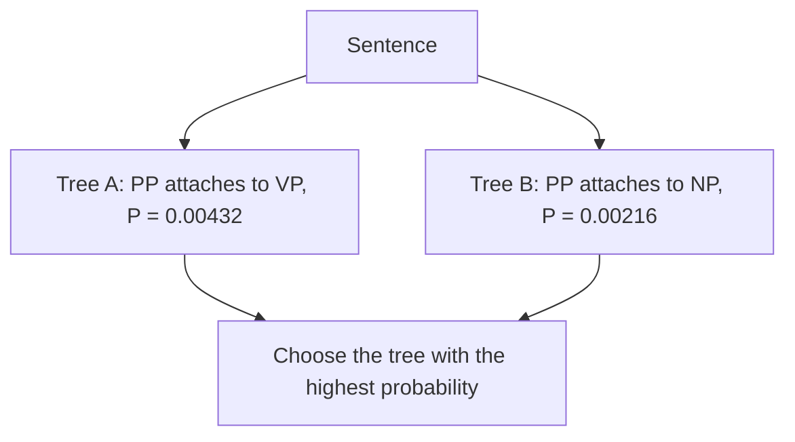

**In simple words:** a PCFG is a context-free grammar in which every rule also has a probability. When a sentence has more than one parse tree, the probabilities tell which tree is the most likely one.

*(The class files do not cover PCFG; this is the standard short answer.)*

**Definition:** a Probabilistic Context-Free Grammar (PCFG) is a CFG whose rules $A \to \beta$ each carry a probability, and the probabilities of all rules with the same left side add up to 1. The probability of a parse tree is the product of the probabilities of the rules used in it.

**Why it is needed:** a plain CFG can give several parse trees for one sentence (ambiguity, for example "I saw the man with the telescope", which the class also uses as an example of syntactic ambiguity <Cite id="class-nlp-pyq4" loc="p. 6" />) and cannot say which one is better. A PCFG ranks the trees.

<Sum>

<Given>

rules with probabilities: S → NP VP [1.0]; NP → Det N [0.6] | NP PP [0.2] | I [0.2]; VP → V NP [0.6] | VP PP [0.4]; PP → P NP [1.0]; Det → the [1.0]; N → man [0.5] | telescope [0.5]; V → saw [1.0]; P → with [1.0]. Sentence: *I saw the man with the telescope*.

</Given>

<Find>

the probability of each parse tree and the better tree.

</Find>

<Steps>

1. **Tree A (the PP belongs to the verb phrase: I used the telescope).** Rules: S → NP VP (1.0), NP → I (0.2), VP → VP PP (0.4), VP → V NP (0.6), V → saw (1), NP → Det N (0.6), Det → the (1), N → man (0.5), PP → P NP (1), P → with (1), NP → Det N (0.6), Det → the (1), N → telescope (0.5).
   $P(A) = 1 \times 0.2 \times 0.4 \times 0.6 \times 0.6 \times 0.5 \times 0.6 \times 0.5 = 0.00432$.
2. **Tree B (the PP belongs to the noun phrase: the man has the telescope).** Rules: S → NP VP (1.0), NP → I (0.2), VP → V NP (0.6), V → saw (1), NP → NP PP (0.2), NP → Det N (0.6), N → man (0.5), PP → P NP (1), NP → Det N (0.6), N → telescope (0.5).
   $P(B) = 1 \times 0.2 \times 0.6 \times 0.2 \times 0.6 \times 0.5 \times 0.6 \times 0.5 = 0.00216$.
3. Compare: $0.00432 > 0.00216$.

</Steps>

<Answer>

Tree A is the more probable parse, with probability $0.00432$ (twice $0.00216$ of tree B).

</Answer>

<Box kind="verify">

The probabilities of rules with the same left side add to 1: NP $0.6 + 0.2 + 0.2 = 1$; VP $0.6 + 0.4 = 1$; N $0.5 + 0.5 = 1$. The two trees differ only in using VP → VP PP (0.4) with VP → V NP (0.6) in A, versus NP → NP PP (0.2) with VP → V NP (0.6) in B, so A is $0.4 / 0.2 = 2$ times B, as found.

</Box>

</Sum>

**Uses:** parsing with ambiguity resolution, speech recognition, machine translation. **Limitation:** rule probabilities ignore the actual words, and the probabilities must be learned from a treebank.

**Conclusion:** a PCFG adds probabilities to CFG rules so the most probable parse can be chosen.
