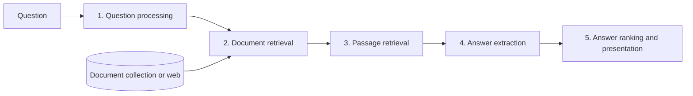

**In simple words:** **question answering system (QAS)** natural language mein question ("Who wrote Gitanjali?") leta hai aur chhota, seedha answer ("Rabindranath Tagore") deta hai, search engine ki tarah documents ki list nahi. <Cite id="pyq-2023-12-ce-ibm-qa" /> <Cite id="ambiguity-challenges-wiki-qa" />

**Ye kyun zaroori hai:** log answer chahte hain, padhne ke liye das links nahi. QA voice assistants, customer-support bots, search engines aur help desks mein use hota hai.

**Architecture (IR-based, classic pipeline).** <Cite id="nlp-applications-slp3-11" />

1. **Question processing:** **answer type** dhoondho (who = person, where = place, when = date, how many = number), **keywords** nikalo, aur search query banao. Named entity recognition aur POS tagging madad karte hain.
2. **Document retrieval:** search (IR) engine query ke liye top documents deta hai.
3. **Passage retrieval:** documents ko sentences ya paragraphs mein kaata jata hai aur keyword overlap aur answer-type match se rank kiya jata hai.
4. **Answer extraction:** best passage se sahi type ka phrase chuno. Example: query "wrote Gitanjali" ko "Gitanjali is a collection of poems by Rabindranath Tagore" milta hai; PERSON entity *Rabindranath Tagore* hai. Modern systems neural **reader** use karte hain (jaise SQuAD pe trained) jo answer span ka start aur end mark karta hai. <Cite id="nlp-applications-squad" />
5. **Ranking aur presentation:** candidate answers ko score karo, best answer source ke saath do.

**QA systems ke types:**

| Type | How it works | Example |
|---|---|---|
| Closed-domain | sirf ek field (medicine, law); domain knowledge use | hospital help bot |
| Open-domain | koi bhi topic; bade text collections | web assistant |
| Extractive | answer text se copy kiya hua span | SQuAD readers |
| Generative | language model apne words mein answer likhta hai | chatbots |
| Knowledge-base QA | question database query ban jata hai | fact table se "capital of India" |

**Challenges:** ambiguous ya vague questions, kai sentences ke upar reasoning, galat ya purane sources, aur answers ko evaluate karna (exact match aur F1 se).

**Conclusion:** QAS question ko query banata hai, best passage dhoondhta hai, aur exact answer extract karta hai.
