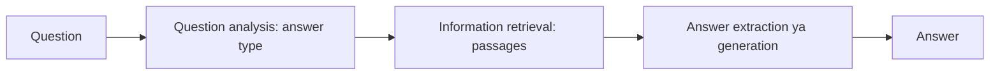

**In simple words:** question answering (QA) system human language mein poochhe gaye question ka precise fact ya short passage se answer deta hai, documents ki lambi list nahi. <Cite id="class-nlp-m6" loc="slide 15" />

**Definition:** a Question Answering (QA) system in NLP is an artificial intelligence program that automatically answers human-language questions with precise facts or short passages instead of returning a long list of whole documents.

**Core architecture and workflow.** Standard QA pipeline ke stages: <Cite id="class-nlp-m6" loc="slides 15-16" />

1. **Question analysis / processing:** question ko tokenize karta hai, stop words hatata hai, part-of-speech (POS) tagging karta hai aur expected answer type pehchaanta hai (person, location, date ya definition, who, what, when jaise words se).
2. **Information retrieval (IR):** document store, knowledge graph ya vector database mein relevant passages ya facts search karta hai.
3. **Answer extraction / generation:** deep learning ya Transformer models (BERT ya generative LLMs) se retrieved context mein se exact answer pinpoint ya synthesize karta hai.

**Main types of QA systems:** <Cite id="class-nlp-m6" loc="slide 16" />

- **Extractive QA:** diye gaye document se exact text span nikaalta hai, start aur end character indices compute karke.
- **Generative (abstractive) QA:** large language model retrieved data ya apne parameters se fluent answer likhta hai.
- **Open-domain:** unrestricted web data (Wikipedia, virtual assistants) se broad questions. **Closed-domain:** specialized vocabulary wala narrow subject (medical, legal).

**Conclusion:** QA question analysis, retrieval aur answer extraction jodkar documents ki list ki jagah seedha answer deta hai.
