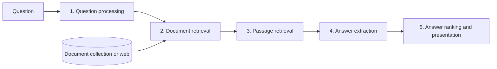

**In simple words:** a **question answering system (QAS)** takes a question in natural language ("Who wrote Gitanjali?") and returns a short, direct answer ("Rabindranath Tagore"), not a list of documents like a search engine. <Cite id="pyq-2023-12-ce-ibm-qa" /> <Cite id="ambiguity-challenges-wiki-qa" />

**Why it is needed:** people want answers, not ten links to read. QA is used in voice assistants, customer-support bots, search engines and help desks.

**Architecture (IR-based, the classic pipeline).** <Cite id="nlp-applications-slp3-11" />

1. **Question processing:** find the **answer type** (who = person, where = place, when = date, how many = number), the **keywords**, and form a search query. Named entity recognition and POS tagging help.
2. **Document retrieval:** the search (IR) engine returns the top documents for the query.
3. **Passage retrieval:** documents are cut into sentences or paragraphs and ranked by keyword overlap and answer-type match.
4. **Answer extraction:** pick the phrase of the right type from the best passage. Example: query "wrote Gitanjali" finds "Gitanjali is a collection of poems by Rabindranath Tagore"; the PERSON entity is *Rabindranath Tagore*. Modern systems use a neural **reader** (for example trained on SQuAD) that marks the start and end of the answer span. <Cite id="nlp-applications-squad" />
5. **Ranking and presentation:** score candidate answers, return the best one with its source.

**Types of QA systems:**

| Type | How it works | Example |
|---|---|---|
| Closed-domain | one field only (medicine, law); uses domain knowledge | hospital help bot |
| Open-domain | any topic; uses large text collections | web assistant |
| Extractive | answer is a span copied from a text | SQuAD readers |
| Generative | a language model writes the answer in its own words | chatbots |
| Knowledge-base QA | question turned into a database query | "capital of India" from a fact table |

**Challenges:** ambiguous or vague questions, reasoning across several sentences, wrong or outdated sources, and evaluating answers (measured by exact match and F1).

**Conclusion:** a QAS turns a question into a query, finds the best passage, and extracts the exact answer.
