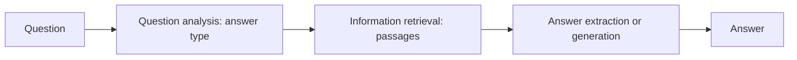

**In simple words:** a question answering (QA) system answers a question asked in human language with a precise fact or short passage, instead of giving a long list of documents. <Cite id="class-nlp-m6" loc="slide 15" />

**Definition:** a Question Answering (QA) system in NLP is an artificial intelligence program that automatically answers human-language questions with precise facts or short passages instead of returning a long list of whole documents.

**Core architecture and workflow.** A standard QA pipeline has these stages: <Cite id="class-nlp-m6" loc="slides 15-16" />

1. **Question analysis / processing:** tokenizes the question, removes stop words, does part-of-speech (POS) tagging and identifies the expected answer type (person, location, date or definition, from words like who, what, when).
2. **Information retrieval (IR):** searches a document store, knowledge graph or vector database for relevant passages or facts.
3. **Answer extraction / generation:** uses deep learning or Transformer models (like BERT or generative LLMs) to pinpoint or synthesize the exact answer from the retrieved context.

**Main types of QA systems:** <Cite id="class-nlp-m6" loc="slide 16" />

- **Extractive QA:** pulls the exact text span from a given document, computing start and end character indices.
- **Generative (abstractive) QA:** a large language model writes a fluent answer from retrieved data or its own parameters.
- **Open-domain:** broad questions from unrestricted web data (Wikipedia, virtual assistants). **Closed-domain:** a narrow subject with special vocabulary (medical, legal).

**Conclusion:** QA combines question analysis, retrieval and answer extraction to give a direct answer instead of a list of documents.
