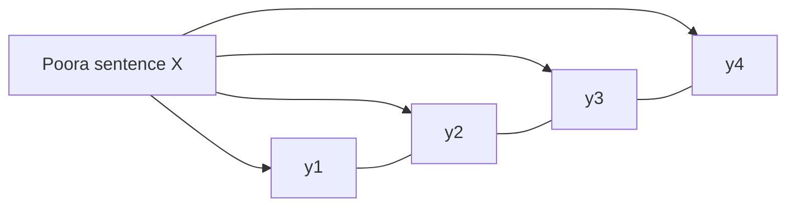

**In simple words:** Conditional Random Field sentence ke har word ko label deta hai, poore sentence ko dekhte hue aur poore label sequence ko ek saath score karte hue. Class ise ek probabilistic model batati hai jo words ka sequence aur context samajhta hai, jisse predictions (jaise entities) zyaada accurate hote hain. <Cite id="class-nlp-m6" loc="slide 39" /> <Cite id="class-nlp-asol" loc="p. 10" />

*(Class files mein CRF ka bas yahi ek line ka description hai; baaki answer standard short explanation hai.)*

**Ye kyun zaroori hai:** HMM maanta hai ki agla tag sirf current tag par depend karta hai aur extra features use nahi kar sakta. <Cite id="class-nlp-pyq3" loc="p. 5" /> MaxEnt (MEMM) rich features use karta hai par har step par locally normalize karta hai, jisse label bias problem aati hai. <Cite id="class-nlp-pyq3" loc="p. 10" /> CRF rich features rakhta hai aur normalization poore sentence par ek baar karta hai.

**Definition:** CRF ek discriminative model hai jo seedhe $P(Y \mid X)$ model karta hai: poore word sequence $X$ diya ho to poore label sequence $Y = (y_1, \ldots, y_n)$ ki probability.

$$
P(Y \mid X) = \frac{1}{Z(X)} \exp\Big(\sum_{i=1}^{n} \sum_{k} \lambda_k f_k(y_{i-1}, y_i, X, i)\Big)
$$

$f_k$ feature functions hain (jaise "word -ing par khatam hota hai aur label VBG hai"), $\lambda_k$ seekhe hue weights hain aur $Z(X)$ saare possible label sequences par jodta hai, isliye normalization global hai.

**Sequence labelling mein kaise use hota hai:**

1. Words, padosi words, word shape aur padosi labels par feature functions define karo.
2. Labelled sentences par weights $\lambda_k$ train karo (iterative optimization).
3. Naye sentence ke liye Viterbi se sabse zyaada probability wala label sequence dhundho.

| Point | HMM | MaxEnt (MEMM) | CRF |
|---|---|---|---|
| Type | Generative, $P(x, y)$ | Discriminative, $P(y \mid x)$ | Discriminative, $P(Y \mid X)$ |
| Rich features | Nahi | Haan | Haan |
| Normalization | Joint model | Local, har step | Global, poora sentence |
| Label bias | Nahi | Haan | Nahi |

**Applications:** POS tagging aur named entity recognition. **Disadvantage:** training HMM ki counting se slow hai.

**Conclusion:** CRF rich features aur global normalization se sequence label karta hai, isliye label bias se bachta hai.
