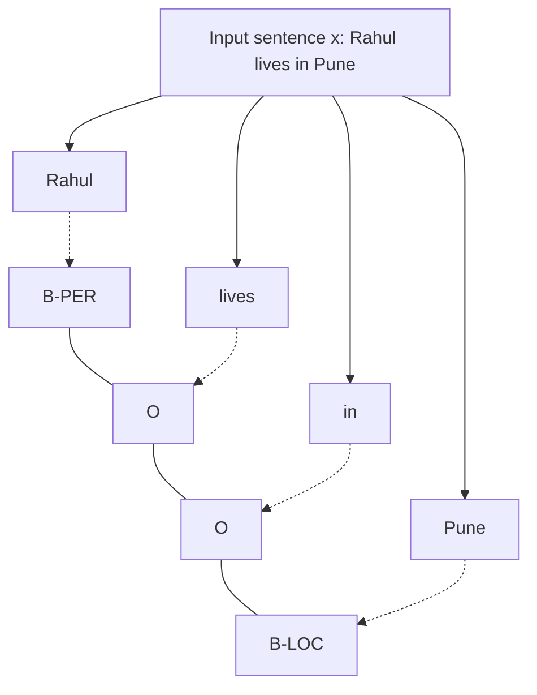

**In simple words:** sequence labeling sequence ke har item ko label deta hai (har word ko POS tag, ya name tag jaise PERSON ya LOCATION). **Conditional Random Field (CRF)** ek probability model hai jo **poora input sentence** dekhta hai aur padosi labels ek doosre ke saath kaise fit hote hain ye dhyan mein rakhke **poori label sequence** chunta hai. <Cite id="hmm-maxent-crf-lafferty2001" /> <Cite id="hmm-maxent-crf-av-crf" />

**Ye kyun zaroori hai:** HMM model karta hai ki labels words kaise generate karte hain, isliye wo sirf current word use kar sakta hai. MEMM ek-ek label alag decide karta hai aur *label bias* problem se grast hai. CRF **discriminative** hai ($P(y \mid x)$ ko seedha model karta hai), poore sentence ke koi bhi features use kar sakta hai, aur poori sequence pe normalize karta hai, jisse label bias nahi hota.

**Kaise kaam karta hai (linear-chain CRF):**

1. **Feature functions** pichla label, current label aur input dekhte hain: $f_k(y_{t-1}, y_t, x, t)$. Examples: "word capitalized hai aur label B-PER", "word -ing pe khatam aur label VERB", "pichla label DT aur current label NN".
2. Har feature ka ek **weight** $w_k$ hota hai (positive use badhata hai, negative ghatata hai).
3. Label sequence ki probability

$$
P(y \mid x) = \frac{1}{Z(x)} \exp\Big( \sum_{t}\sum_{k} w_k\, f_k(y_{t-1}, y_t, x, t) \Big)
$$

jahan $Z(x)$ saari possible label sequences ke scores jodta hai taaki probabilities ka total 1 ho.

4. **Training:** labelled sentences se weights seekho, conditional log-likelihood ko gradient methods (jaise L-BFGS) se maximize karke; forward-backward algorithm $Z(x)$ nikalta hai.
5. **Decoding:** **Viterbi** algorithm se best label sequence dhoondho. <Cite id="hmm-maxent-crf-sutton-mccallum" />

**Example:** "Rahul lives in Pune" mein "capitalized word" jaise features *Rahul* ko B-PER aur *Pune* ko B-LOC ki taraf dhakelte hain, aur *lives* aur *in* ko O milta hai.

| Point | HMM | MEMM | CRF |
|---|---|---|---|
| Type | generative | discriminative | discriminative |
| Models | $P(x, y)$ | $P(y_t \mid y_{t-1}, x)$ per step | $P(y \mid x)$ for whole sequence |
| Features | current word only | any | any, overlapping |
| Label bias | no | yes | no |

**Advantages:** rich features, classical taggers mein sabse achhi accuracy. **Disadvantages:** training slow, aur features haath se design karne padte hain. <Cite id="pos-tagging-gfg-crf" />

**Conclusion:** CRF poori label sequences ko weighted features se score karta hai aur Viterbi se decode karta hai; ye POS tagging aur named entity recognition mein bahut use hota hai.
