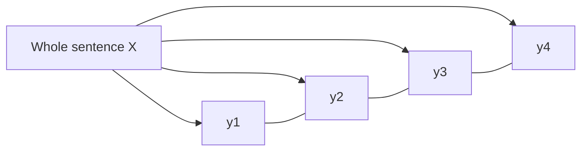

**In simple words:** a Conditional Random Field labels every word of a sentence, looking at the whole sentence and scoring the whole label sequence together. The class describes it as a probabilistic model that understands the sequence and context of words, which helps in making predictions (for example entities) more accurate. <Cite id="class-nlp-m6" loc="slide 39" /> <Cite id="class-nlp-asol" loc="p. 10" />

*(The class files give only this one-line description of CRF; the rest of this answer is the standard short explanation.)*

**Why it is needed:** the HMM assumes the next tag depends only on the current tag and cannot use extra features. <Cite id="class-nlp-pyq3" loc="p. 5" /> MaxEnt (MEMM) uses rich features but normalizes locally at each step, which gives the label bias problem. <Cite id="class-nlp-pyq3" loc="p. 10" /> A CRF keeps the rich features and normalizes once over the whole sentence.

**Definition:** a CRF is a discriminative model that directly models $P(Y \mid X)$: the probability of the whole label sequence $Y = (y_1, \ldots, y_n)$ given the whole word sequence $X$.

$$
P(Y \mid X) = \frac{1}{Z(X)} \exp\Big(\sum_{i=1}^{n} \sum_{k} \lambda_k f_k(y_{i-1}, y_i, X, i)\Big)
$$

$f_k$ are feature functions (for example "word ends in -ing and the label is VBG"), $\lambda_k$ are learned weights and $Z(X)$ adds over all possible label sequences, so the normalization is global.

**How it is used for sequence labelling:**

1. Define feature functions on words, neighbours, word shape and neighbouring labels.
2. Train the weights $\lambda_k$ on labelled sentences (iterative optimization).
3. For a new sentence, find the label sequence with the highest probability using Viterbi.

| Point | HMM | MaxEnt (MEMM) | CRF |
|---|---|---|---|
| Type | Generative, $P(x, y)$ | Discriminative, $P(y \mid x)$ | Discriminative, $P(Y \mid X)$ |
| Rich features | No | Yes | Yes |
| Normalization | Joint model | Local, each step | Global, whole sentence |
| Label bias | No | Yes | No |

**Applications:** POS tagging and named entity recognition. **Disadvantage:** training is slower than counting for an HMM.

**Conclusion:** a CRF labels a sequence using rich features and global normalization, so it avoids label bias.
