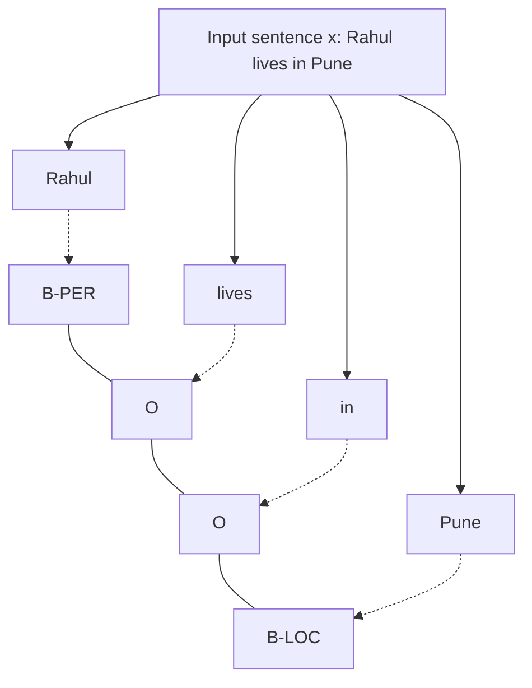

**In simple words:** sequence labeling gives a label to every item in a sequence (a POS tag to each word, or a name tag such as PERSON or LOCATION). A **Conditional Random Field (CRF)** is a probability model that looks at the **whole input sentence** and picks the best **whole label sequence**, taking into account how neighbouring labels fit together. <Cite id="hmm-maxent-crf-lafferty2001" /> <Cite id="hmm-maxent-crf-av-crf" />

**Why it is needed:** an HMM models how labels generate words, so it can use only the current word. A MEMM decides one label at a time and suffers from the *label bias* problem. A CRF is **discriminative** (it models $P(y \mid x)$ directly), can use any features of the whole sentence, and normalizes over the whole sequence, which avoids label bias.

**How it works (linear-chain CRF):**

1. **Feature functions** look at the previous label, the current label and the input: $f_k(y_{t-1}, y_t, x, t)$. Examples: "word is capitalized and label is B-PER", "word ends in -ing and label is VERB", "previous label is DT and current label is NN".
2. Each feature has a **weight** $w_k$ (positive favours it, negative discourages it).
3. The probability of a label sequence is

$$
P(y \mid x) = \frac{1}{Z(x)} \exp\Big( \sum_{t}\sum_{k} w_k\, f_k(y_{t-1}, y_t, x, t) \Big)
$$

where $Z(x)$ adds the score of all possible label sequences so the probabilities total 1.

4. **Training:** learn the weights from labelled sentences by maximizing the conditional log-likelihood with gradient methods (for example L-BFGS); the forward-backward algorithm computes $Z(x)$.
5. **Decoding:** find the best label sequence with the **Viterbi** algorithm. <Cite id="hmm-maxent-crf-sutton-mccallum" />

**Example:** for "Rahul lives in Pune", features such as "capitalized word" push *Rahul* to B-PER and *Pune* to B-LOC, while *lives* and *in* get O.

| Point | HMM | MEMM | CRF |
|---|---|---|---|
| Type | generative | discriminative | discriminative |
| Models | $P(x, y)$ | $P(y_t \mid y_{t-1}, x)$ per step | $P(y \mid x)$ for whole sequence |
| Features | current word only | any | any, overlapping |
| Label bias | no | yes | no |

**Advantages:** rich features, best accuracy among classical taggers. **Disadvantages:** slower training, and features must be designed by hand. <Cite id="pos-tagging-gfg-crf" />

**Conclusion:** a CRF scores whole label sequences with weighted features and decodes with Viterbi; it is widely used for POS tagging and named entity recognition.
