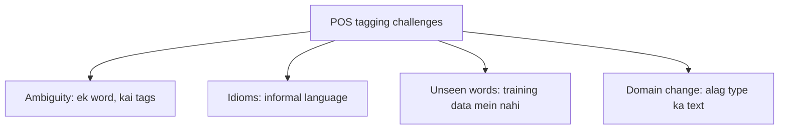

**In simple words:** POS tagging har word ko ek grammatical label deti hai, aur chaar cheezein ise mushkil banati hain. <Cite id="class-nlp-pyq3" loc="p. 4" />

**Definition:** POS tagging sentence ke har word ko ek grammatical category deti hai, jaise noun, verb, adjective ya adverb. <Cite id="class-nlp-pyq3" loc="p. 4" />

**Challenges** <Cite id="class-nlp-pyq3" loc="p. 5" />

1. **Ambiguity:** ek word ke context ke hisaab se kai meanings ya tags ho sakte hain. *Book* "read a book" mein noun hai aur "book a ticket" mein verb.
2. **Idiomatic expressions:** informal language aur idioms ko sahi tag karna mushkil hai.
3. **Out-of-vocabulary words:** pehle na dekhe gaye words (naye words, names) galat tags dete hain.
4. **Domain dependence:** model apni training domain ke bahar achha nahi chalta (news text versus tweets).

**Conclusion:** zyaadatar tagging errors ambiguity aur unseen words se aate hain.
