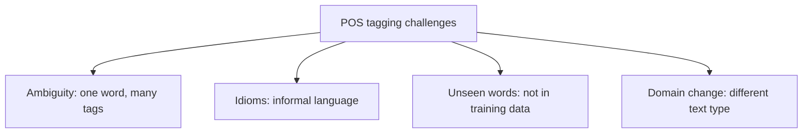

**In simple words:** POS tagging gives each word a grammatical label, and four things make it hard. <Cite id="class-nlp-pyq3" loc="p. 4" />

**Definition:** POS tagging assigns each word in a sentence a grammatical category such as noun, verb, adjective or adverb. <Cite id="class-nlp-pyq3" loc="p. 4" />

**Challenges** <Cite id="class-nlp-pyq3" loc="p. 5" />

1. **Ambiguity:** a word can have several meanings or tags depending on the context. *Book* is a noun in "read a book" and a verb in "book a ticket".
2. **Idiomatic expressions:** informal language and idioms are hard to tag correctly.
3. **Out-of-vocabulary words:** words not seen before (new words, names) lead to wrong tags.
4. **Domain dependence:** a model may not work well outside the domain it was trained on (news text versus tweets).

**Conclusion:** most tagging errors come from ambiguity and unseen words.
