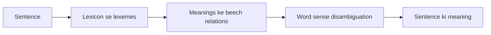

**In simple words:** semantic analysis NLP ka wo step hai jo words aur sentences ki meaning nikalta hai, sirf grammar nahi.

*(Class files semantic analysis ko alag topic ki tarah nahi batatin; wo iska word-level part, lexical semantics, cover karti hain. Baaki standard short answer hai.)*

**Definition:** semantic analysis text ki meaning nikalta hai. Iska word-level part **lexical semantics** hai: individual words (lexemes) ki meaning aur unke beech ke relations. **Lexeme** ek single word ya phrase hai jiski specific meaning hoti hai, aur **lexicon** ek language ke saare lexemes ka collection hai. <Cite id="class-nlp-pyq4" loc="p. 9" />

**Steps:**

1. Lexicon se lexemes aur unki meanings dhundho.
2. Relations use karo (synonymy, antonymy, hyponymy, meronymy, polysemy, homonymy). <Cite id="class-nlp-pyq4" loc="p. 10" />
3. Context se ambiguous word ki sahi meaning chuno (word sense disambiguation). <Cite id="class-nlp-pyq4" loc="p. 5" />
4. Word meanings ko jodkar sentence ki meaning banao.

**Example:** "He went to the bank." Lexeme *bank* ki do unrelated meanings hain (financial institution, nadi ka kinara), isliye semantic analysis ko context se ek chunni padti hai. <Cite id="class-nlp-pyq4" loc="p. 2" /> <Cite id="class-nlp-pyq4" loc="p. 6" />

**Conclusion:** semantic analysis lexicon, lexical relations aur disambiguation se words se meaning tak jaata hai.
