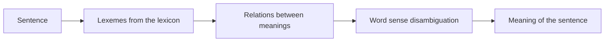

**In simple words:** semantic analysis is the step of NLP that finds the meaning of words and sentences, not only their grammar.

*(The class files do not describe semantic analysis as a topic; they cover its word-level part, lexical semantics. The rest is the standard short answer.)*

**Definition:** semantic analysis finds the meaning of text. Its word-level part is **lexical semantics**: the meaning of individual words (lexemes) and the relations between them. A **lexeme** is a single word or phrase with a specific meaning, and a **lexicon** is the entire collection of lexemes in a language. <Cite id="class-nlp-pyq4" loc="p. 9" />

**Steps:**

1. Find the lexemes and their meanings from the lexicon.
2. Use the relations (synonymy, antonymy, hyponymy, meronymy, polysemy, homonymy). <Cite id="class-nlp-pyq4" loc="p. 10" />
3. Choose the right meaning of an ambiguous word from its context (word sense disambiguation). <Cite id="class-nlp-pyq4" loc="p. 5" />
4. Combine the word meanings into the meaning of the sentence.

**Example:** "He went to the bank." The lexeme *bank* has two unrelated meanings (financial institution, river side), so semantic analysis must use the context to choose one. <Cite id="class-nlp-pyq4" loc="p. 2" /> <Cite id="class-nlp-pyq4" loc="p. 6" />

**Conclusion:** semantic analysis moves from words to meaning using the lexicon, lexical relations and disambiguation.
