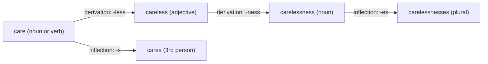

**In simple words:** morphology padhta hai ki words chhote meaningful parts se kaise bante hain, jinhe **morphemes** kehte hain. Word mein ek **stem** (core) hota hai aur **affixes** (aage prefix, peeche suffix). Affixes do tarah se jode ja sakte hain: inflection aur derivation. <Cite id="morphology-fst-gfg-morph" /> <Cite id="morphology-fst-jm-ch3-notes" />

**Inflectional morphology**

- Grammar ki detail dikhane ke liye suffix jodta hai: plural, tense, person, comparison.
- Word ka **part of speech wahi rehta hai** aur **basic meaning bhi wahi**.
- English mein sirf 8 inflectional suffixes hain: -s (plural), -'s (possessive), -s (3rd person verb), -ed, -ing, -en (past participle), -er aur -est. <Cite id="morphology-fst-wiki-inflection" />
- Example: *cat* → *cats*, *walk* → *walks*, *walked*, *walking*, *tall* → *taller*. Sab wahi word family hai, bas alag grammatical forms mein.

**Derivational morphology**

- Prefix ya suffix jodke **naya word** banata hai, aksar naye meaning ke saath aur aksar **naye part of speech** ke saath.
- Example: *happy* (adjective) → *happiness* (noun), *unhappy* (adjective, ulta meaning); *teach* (verb) → *teacher* (noun); *nation* → *national* → *nationalize* → *nationalization*. <Cite id="morphology-fst-wiki-derivation" />
- Kam regular: har stem har affix nahi leta (*arrive* → *arrival*, lekin *\*arrivation* nahi).

<Cite id="morphology-fst-jm-ch3-notes" loc="diagram" />

Word ke andar order dekho: derivational affixes **stem ke paas** hote hain aur inflectional **sabse last** mein (*care-less-ness-es*, *care-es-less* nahi).

**Comparison**

| Point | Inflectional | Derivational |
|---|---|---|
| Purpose | Grammatical form | Naya word banana |
| Part of speech | Nahi badalta | Aksar badalta hai |
| Meaning | Same core meaning | Naya ya badla meaning |
| Number of affixes | Kam (English mein 8) | Bahut zyada |
| Position | Last, sabse bahar | Stem ke paas |
| Regularity | Bahut regular | Aksar irregular |
| Example | *walk → walked* | *walk → walker* |

**NLP mein use:** stemmers aur lemmatizers ye affixes hatate hain. *walks* ki search *walked* ko bhi dhoondhe, aur morphological analyser (aksar finite-state transducer) *carelessness* ko care + less + ness mein todta hai.

**Conclusion:** inflection word ka form badalta hai bina naya word banaye; derivation naya word banata hai, aksar naye meaning ya part of speech ke saath.
