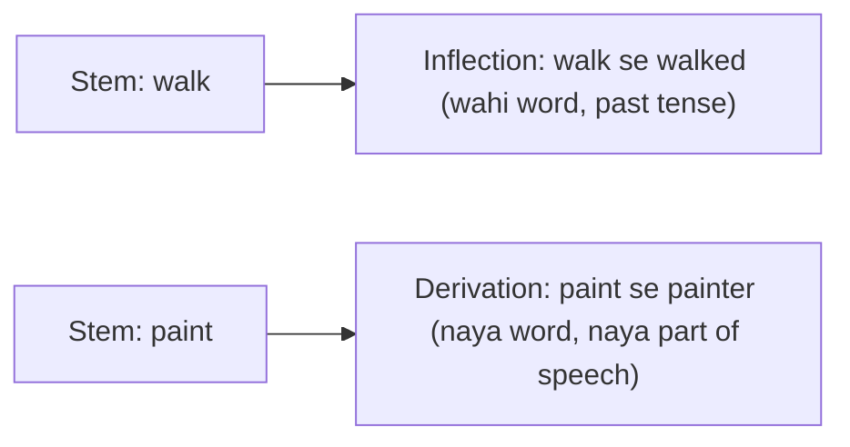

**In simple words:** inflection word ka form badalti hai bina naya word banaye; derivation naya word banati hai.

| Point | Inflectional morphology | Derivational morphology |
|---|---|---|
| Definition | Un processes ka study, jinme affixation aur vowel change shamil hain, jo certain grammatical categories mein word forms ko alag karte hain | Naye lexemes banana: aise words jo syntactic category (part of speech) ya meaning mein apne base se alag hon |
| Kya karti hai | Maujood words mein changes | Naye words ka creation |
| Result | Wahi word, alag form | Alag word |
| Categories | Number, tense, person, case, gender | Part of speech ya meaning |
| Examples | School se schools, walk se walked, man se men, go se going | paint (verb) + er se painter (noun, jo paint karta hai) |

<Cite id="class-nlp-pyq2" loc="p. 3" /> <Cite id="class-nlp-pyq2" loc="p. 4" />

**English ke inflectional affixes:** nouns par plural -s (dog, dogs); verbs par past tense -ed (call, called); third person singular -s aur present participle -ing verbs par; short adjectives par comparative aur superlative ke liye -er aur -est. <Cite id="class-nlp-pyq2" loc="p. 3" />

**Derivational:** \{-er\} verb ko noun banata hai, usually jo action karta hai wo person ya cheez: paint (v.) + -er se painter (n.) banta hai. <Cite id="class-nlp-pyq2" loc="p. 4" /> Class ke FSA drawings aur dikhate hain: success + ful (successful) aur friend + ly (friendly) noun se adjective banate hain, aur install + ment (installment) verb se noun banata hai. <Cite id="class-nlp-m2" loc="p. 5" /> <Cite id="class-nlp-m2" loc="p. 7" />

**Conclusion:** inflectional morphology maujood words ka form badalti hai; derivational morphology naye words banati hai.
