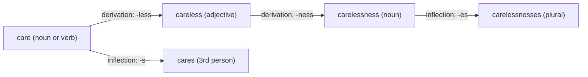

**In simple words:** morphology studies how words are built from smaller meaningful parts called **morphemes**. A word has a **stem** (the core) and **affixes** (prefix at the front, suffix at the end). Affixes can be added in two different ways: inflection and derivation. <Cite id="morphology-fst-gfg-morph" /> <Cite id="morphology-fst-jm-ch3-notes" />

**Inflectional morphology**

- Adds a suffix to show a grammatical detail: plural, tense, person, comparison.
- The word stays the **same part of speech** and the **same basic meaning**.
- English has only 8 inflectional suffixes: -s (plural), -'s (possessive), -s (3rd person verb), -ed, -ing, -en (past participle), -er and -est. <Cite id="morphology-fst-wiki-inflection" />
- Example: *cat* → *cats*, *walk* → *walks*, *walked*, *walking*, *tall* → *taller*. All are still the same word family, just in different grammatical forms.

**Derivational morphology**

- Adds a prefix or suffix to make a **new word**, often with a new meaning and often a **new part of speech**.
- Example: *happy* (adjective) → *happiness* (noun), *unhappy* (adjective, opposite meaning); *teach* (verb) → *teacher* (noun); *nation* → *national* → *nationalize* → *nationalization*. <Cite id="morphology-fst-wiki-derivation" />
- Less regular: not every stem takes every affix (*arrive* → *arrival*, but not *\*arrivation*).

<Cite id="morphology-fst-jm-ch3-notes" loc="diagram" />

Note the order inside a word: derivational affixes sit **closer to the stem** and inflectional ones come **last** (*care-less-ness-es*, not *care-es-less*).

**Comparison**

| Point | Inflectional | Derivational |
|---|---|---|
| Purpose | Grammatical form | Makes a new word |
| Part of speech | Does not change | Often changes |
| Meaning | Same core meaning | New or changed meaning |
| Number of affixes | Few (8 in English) | Very many |
| Position | Last, outermost | Closer to the stem |
| Regularity | Very regular | Often irregular |
| Example | *walk → walked* | *walk → walker* |

**Use in NLP:** stemmers and lemmatizers remove these affixes. A search for *walks* should also find *walked*, and a morphological analyser (often a finite-state transducer) splits *carelessness* into care + less + ness.

**Conclusion:** inflection changes the form of a word without making a new word; derivation builds a new word, usually with a new meaning or part of speech.
