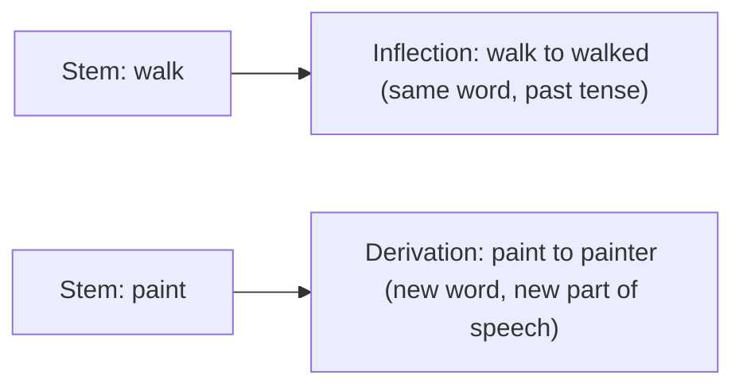

**In simple words:** inflection changes the form of a word without making a new word; derivation builds a new word.

| Point | Inflectional morphology | Derivational morphology |
|---|---|---|
| Definition | The study of processes, including affixation and vowel change, that distinguish word forms in certain grammatical categories | Concerned with forming new lexemes: words that differ in syntactic category (part of speech) or in meaning from their bases |
| Deals with | Changes made to existing words | The creation of new words |
| Result | A different form of the same word | A separate word |
| Categories | Number, tense, person, case, gender | Part of speech or meaning |
| Examples | School to schools, walk to walked, man to men, go to going | paint (verb) + er gives painter (noun, someone who paints) |

<Cite id="class-nlp-pyq2" loc="p. 3" /> <Cite id="class-nlp-pyq2" loc="p. 4" />

**Inflectional affixes in English:** plural -s on nouns (dog, dogs); past tense -ed on verbs (call, called); third person singular -s and the present participle -ing on verbs; -er and -est on short adjectives for comparative and superlative. <Cite id="class-nlp-pyq2" loc="p. 3" />

**Derivational:** \{-er\} turns a verb into a noun, usually meaning the person or thing that does the action: paint (v.) + -er makes painter (n.). <Cite id="class-nlp-pyq2" loc="p. 4" /> The FSA drawings in the class show more: success + ful (successful) and friend + ly (friendly) make adjectives from nouns, and install + ment (installment) makes a noun from a verb. <Cite id="class-nlp-m2" loc="p. 5" /> <Cite id="class-nlp-m2" loc="p. 7" />

**Conclusion:** inflectional morphology changes the form of existing words; derivational morphology creates new words.
