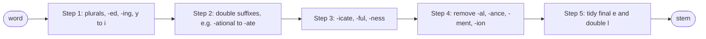

**In simple words:** Porter stemmer (Martin Porter, 1980) rules ki ek fixed list se English words ke endings kaat deta hai, taaki *connect, connected, connection* sab *connect* ban jayein. Ye kabhi dictionary nahi dekhta. <Cite id="porter-stemmer-def" /> <Cite id="porter-stemmer-gfg-stemming" />

**Key idea: measure m.** Word ko `[C](VC)^m[V]` ki tarah likho, jahan C consonants ka run hai aur V vowels ka. Measure $m$ VC pairs ginta hai aur batata hai ki stem kitna lamba hai. Example: *tree* m = 0, *trouble* m = 1, *troubles* m = 2. Rule tabhi chalta hai jab bacha hua stem kaafi lamba ho (jaise m > 0 ya m > 1). Dusri conditions: stem mein vowel ho (isse *sing* ka *-ing* nahi katta), double consonant pe khatam ho, ya consonant-vowel-consonant pe khatam ho. <Cite id="porter-stemmer-def" loc="§2" />

**Paanch steps, order mein.** Har step mein sirf sabse lamba matching suffix use hota hai.

<Cite id="porter-stemmer-snowball" loc="diagram" />

| Step | Job | Rule aur example |
|---|---|---|
| 1a | Plurals | sses → ss (*caresses → caress*), ies → i (*ponies → poni*), s → nothing (*cats → cat*) |
| 1b, 1c | -ed, -ing; y → i | (*v*) ing → nothing (*motoring → motor*); *hopping → hop* (double letter hata); *happy → happi* |
| 2 | Lambe suffixes, m > 0 | ational → ate (*relational → relate*), tional → tion (*conditional → condition*) |
| 3 | m > 0 | icate → ic (*triplicate → triplic*), ful → nothing (*hopeful → hope*), ness → nothing (*goodness → good*) |
| 4 | Suffix hatao, m > 1 | al, ance, ment, ion... (*revival → reviv*, *adjustment → adjust*) |
| 5 | Final tidy | e hatao agar m > 1 (*probate → probat*); ll → l agar m > 1 (*controll → control*) |

<Sum>

<Given>

word *generalizations*.

</Given>

<Find>

uska Porter stem, step by step.

</Find>

<Steps>

1. **Step 1a.** Word *s* pe khatam hota hai, to plain S rule use hata deta hai: *generalization*. *Reason: ye plural hai.*
2. **Steps 1b aur 1c.** Na *-eed, -ed, -ing* hai na final *y*: koi change nahi.
3. **Step 2.** Rule *ization → ize* lagta hai. Left stem *general* ka m = 3 (gen-er-al) hai, jo 0 se zyada hai: *generalize*.
4. **Step 3.** Rule *alize → al* lagta hai. Stem *gener* ka m = 2 > 0: *general*.
5. **Step 4.** Rule *al → nothing* ko m > 1 chahiye. Stem *gener* ka m = 2 hai: *gener*.
6. **Step 5.** Word *e* ya *ll* pe khatam nahi hota: koi change nahi.

</Steps>

<Answer>

generalizations → generalization → generalize → general → **gener**

</Answer>

<Box kind="verify">

*gener* ka measure: g | en | er se C (VC)(VC), to m = 2, isiliye step 4 allowed tha. Same input original Porter algorithm (NLTK, original mode) pe chalane se bhi *gener* aata hai.

</Box>

</Sum>

**Limits:** ye over-stem kar sakta hai (*university* aur *universe* dono *univers* ban sakte hain) aur under-stem bhi, aur stem aksar real word nahi hota (*happi*). Ye sirf English ke liye bana hai.

**Conclusion:** Porter stemmer paanch ordered steps mein suffixes hatata hai, har step ek measure condition se guarded hai, aur ek fast, dictionary-free root deta hai.
