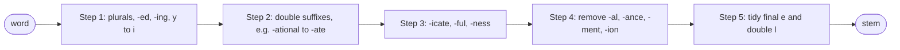

**In simple words:** the Porter stemmer (Martin Porter, 1980) cuts the endings off English words using a fixed list of rules, so that *connect, connected, connection* all become *connect*. It never looks up a dictionary. <Cite id="porter-stemmer-def" /> <Cite id="porter-stemmer-gfg-stemming" />

**Key idea: the measure m.** Write a word as `[C](VC)^m[V]`, where C is a run of consonants and V a run of vowels. The measure $m$ counts the VC pairs and says how long the stem is. Example: *tree* m = 0, *trouble* m = 1, *troubles* m = 2. A rule fires only if the remaining stem is long enough (for example m > 0 or m > 1). Other conditions: the stem contains a vowel (this stops *sing* losing its *-ing*), ends in a double consonant, or ends consonant-vowel-consonant. <Cite id="porter-stemmer-def" loc="§2" />

**Five steps, applied in order.** In each step only the longest matching suffix is used.

<Cite id="porter-stemmer-snowball" loc="diagram" />

| Step | Job | Rule and example |
|---|---|---|
| 1a | Plurals | sses → ss (*caresses → caress*), ies → i (*ponies → poni*), s → nothing (*cats → cat*) |
| 1b, 1c | -ed, -ing; y → i | (*v*) ing → nothing (*motoring → motor*); *hopping → hop* (double letter dropped); *happy → happi* |
| 2 | Long suffixes, m > 0 | ational → ate (*relational → relate*), tional → tion (*conditional → condition*) |
| 3 | m > 0 | icate → ic (*triplicate → triplic*), ful → nothing (*hopeful → hope*), ness → nothing (*goodness → good*) |
| 4 | Remove suffix, m > 1 | al, ance, ment, ion... (*revival → reviv*, *adjustment → adjust*) |
| 5 | Final tidy | remove e if m > 1 (*probate → probat*); ll → l if m > 1 (*controll → control*) |

<Sum>

<Given>

the word *generalizations*.

</Given>

<Find>

its Porter stem, step by step.

</Find>

<Steps>

1. **Step 1a.** The word ends in *s*, so the plain S rule removes it: *generalization*. *Reason: it is a plural.*
2. **Steps 1b and 1c.** No *-eed, -ed, -ing* and no final *y*: no change.
3. **Step 2.** The rule *ization → ize* applies. The left stem *general* has m = 3 (gen-er-al), which is more than 0: *generalize*.
4. **Step 3.** The rule *alize → al* applies. The stem *gener* has m = 2 > 0: *general*.
5. **Step 4.** The rule *al → nothing* needs m > 1. The stem *gener* has m = 2: *gener*.
6. **Step 5.** The word does not end in *e* or *ll*: no change.

</Steps>

<Answer>

generalizations → generalization → generalize → general → **gener**

</Answer>

<Box kind="verify">

Measure of *gener*: g | en | er gives C (VC)(VC), so m = 2, which is why step 4 was allowed. The same input run through the original Porter algorithm (NLTK, original mode) also gives *gener*.

</Box>

</Sum>

**Limits:** it can over-stem (*university* and *universe* may both give *univers*) and under-stem, and the stem is often not a real word (*happi*). It is built for English only.

**Conclusion:** Porter's stemmer strips suffixes in five ordered steps, each guarded by a measure condition, giving a fast, dictionary-free root.
