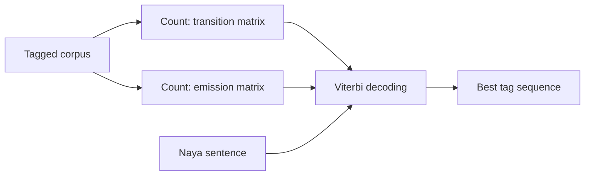

**In simple words:** HMM, jo dikh raha hai usse andaza lagata hai ki parde ke peeche kya ho raha hai. POS tagging mein tags hidden hain aur words dikhte hain, isliye HMM words ke liye sabse likely tags dhundhta hai. <Cite id="class-nlp-pyq3" loc="p. 2" />

**Definition:** Hidden Markov Model ek statistical model hai jo un systems ko samajhne ke liye use hota hai jinki asli states seedhe dikhti nahi, par hum wo outcomes dekh sakte hain jo in hidden states par depend karte hain. <Cite id="class-nlp-pyq3" loc="p. 2" />

**Roz ki analogy:** aap bahar dekh kar mausam nahi dekh sakte, par aap logon ko kuch karte dekhte ho (walk, shop, clean). Ye actions hidden mausam ke clues dete hain.

**Components** <Cite id="class-nlp-pyq3" loc="p. 3" />

1. **States:** hidden conditions (POS tagging mein tags).
2. **Observations:** jo signals hum dekh sakte hain (words).
3. **Transition probabilities:** ek hidden state se doosri mein jaane ki probability (tag se agla tag).
4. **Emission probabilities:** ek state se ek observation nikalne ki probability (tag se word). Example mein, mausam Rainy ho to: walk 0.1, shop 0.4, clean 0.5.
5. **Initial state probabilities:** system ke har state se shuru hone ki probability.

**POS tagging ke liye HMM:** model tagged corpus mein counting se seekha jaata hai. <Cite id="class-nlp-pyq3" loc="p. 7" />

$$
P(t_j \mid t_i) = \frac{\text{Count}(t_i \to t_j)}{\text{Count}(t_i)}, \qquad P(\text{word} \mid \text{tag}) = \frac{\text{Count}(\text{word}, \text{tag})}{\text{Count}(\text{tag})}
$$

Phir **Viterbi algorithm** sabse zyaada probability wala tag sequence dhundhta hai: $\delta_t(j)$ us best probability ko kehte hain jisme koi bhi tag path word $t$ par tag $j$ tak pahunchta hai, aur pichhle tag ka back-pointer saath rakhta hai. End mein back-pointers follow karke tags padhte hain. <Cite id="class-nlp-pyq3" loc="p. 7" />

**Limitation:** ye maanta hai ki agla tag sirf current tag par depend karta hai, aur extra clues aasani se use nahi kar sakta. <Cite id="class-nlp-pyq3" loc="p. 5" />

**Conclusion:** HMM tagger counting se seekhe transition aur emission probabilities use karta hai, aur Viterbi se best tags chunta hai.
