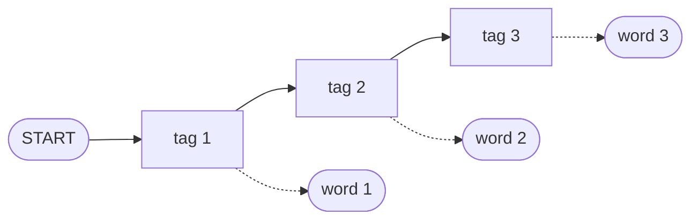

**In simple words:** HMM tagger tags ko ek hidden chain maanta hai. Har tag pichhle tag pe depend karta hai, aur har tag ek word produce karta hai. Words diye hone par ye wo tag sequence dhoondhta hai jo sabse zyada probable ho. <Cite id="hmm-maxent-crf-slp3-ch18" loc="§18.4" /> <Cite id="pos-tagging-gfg-hmm" />

**Model ke parts:** states = tags (N, V, M...); observations = words; transition probability $P(\text{tag}_i \mid \text{tag}_{i-1})$; emission probability $P(\text{word}_i \mid \text{tag}_i)$. <Cite id="hmm-maxent-crf-slp3-appA" loc="§A.2" />

**Do assumptions:** tag sirf pichhle tag pe depend karta hai (Markov), aur word sirf apne tag pe depend karta hai.

<Cite id="hmm-maxent-crf-slp3-ch18" loc="Fig. 18.11" />

**Working:**

1. **Train** tagged corpus ginke: transition = $C(\text{prev},\text{tag})/C(\text{prev})$ aur emission = $C(\text{tag},\text{word})/C(\text{tag})$.
2. **Decode** naya sentence: wo tags chuno jo $\prod_i P(w_i \mid t_i)\,P(t_i \mid t_{i-1})$ ko maximum karein.
3. Har tag path try karna bahut slow hai ($k^n$), isliye **Viterbi** algorithm use karo: har word aur tag ke liye sirf best score aur ek backpointer rakho. <Cite id="pos-tagging-wiki-viterbi" />

<Sum>

<Given>

Tagged corpus (N noun, M modal, V verb): `Martin/N Justin/N can/M watch/V Will/N`, `Spot/N will/M watch/V Martin/N`, `Will/N Justin/N spot/V Martin/N`, `Martin/N will/M pat/V Spot/N`. Capital aur small letters alag words hain.

</Given>

<Find>

"Justin will spot Will" ke best tags.

</Find>

<Steps>

1. Tag counts: N = 10, M = 3, V = 4.
2. Emissions: P(Justin|N) = 2/10 = 0.2, P(Will|N) = 0.2, P(will|M) = 2/3, P(spot|V) = 1/4.
3. Transitions (har tag se nikalti moves): `<S>`→N = 4/4 = 1; N→N = 2/10, N→M = 3/10, N→V = 1/10, N→end = 4/10; M→V = 3/3 = 1; V→N = 4/4 = 1.
4. Viterbi, word by word (0 matlab wo tag us word ko produce nahi kar sakta; N sirf capital *Will* emit karta hai, small *will* kabhi nahi):

| Tag | Justin | will | spot | Will |
|---|---|---|---|---|
| N | 1 × 0.2 = 0.2 | 0 | 0 | 0.01 × 1 × 0.2 = 0.002 |
| M | 0 | 0.2 × 0.3 × 2/3 = 0.04 | 0 | 0 |
| V | 0 | 0 | max(0, 0.04 × 1) × 1/4 = 0.01 | 0 |

5. End: 0.002 × P(end|N) = 0.002 × 0.4 = 0.0008. Backpointers: N ← V ← M ← N.

</Steps>

<Answer>

Justin/N will/M spot/V Will/N, probability 0.0008 ke saath.

</Answer>

<Box kind="verify">

Path pe ek hi product: $1 \times 0.2 \times 0.3 \times \tfrac23 \times 1 \times \tfrac14 \times 1 \times 0.2 \times 0.4 = 0.0008$. Baaki har path mein zero hai, kyunki ya to tag word emit nahi kar sakta ya wo move kabhi dekhi nahi gayi. Rows ka sum 1 hai: N out = 0.2 + 0.3 + 0.1 + 0.4.

</Box>

</Sum>

**Advantages:** simple, fast, sirf counts chahiye. **Disadvantages:** extra clues (suffix, capital letter) use nahi kar sakta, unknown words pe weak, zero counts ke liye smoothing chahiye, sirf pichhla tag dekhta hai.

**Conclusion:** HMM tagger tagged corpus se transition aur emission tables seekhta hai aur Viterbi se sabse probable tag sequence deta hai.
