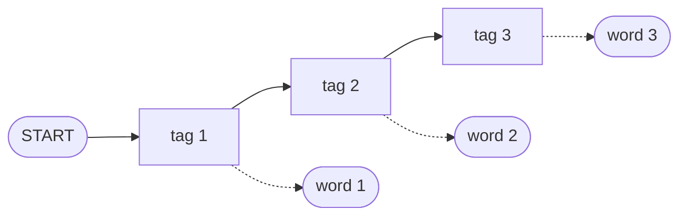

**In simple words:** an HMM tagger treats the tags as a hidden chain. Each tag depends on the tag before it, and each tag produces a word. Given the words, it finds the tag sequence that is most probable. <Cite id="hmm-maxent-crf-slp3-ch18" loc="§18.4" /> <Cite id="pos-tagging-gfg-hmm" />

**Parts of the model:** states = tags (N, V, M...); observations = words; transition probability $P(\text{tag}_i \mid \text{tag}_{i-1})$; emission probability $P(\text{word}_i \mid \text{tag}_i)$. <Cite id="hmm-maxent-crf-slp3-appA" loc="§A.2" />

**Two assumptions:** a tag depends only on the previous tag (Markov), and a word depends only on its own tag.

<Cite id="hmm-maxent-crf-slp3-ch18" loc="Fig. 18.11" />

**Working:**

1. **Train** by counting a tagged corpus: transition = $C(\text{prev},\text{tag})/C(\text{prev})$ and emission = $C(\text{tag},\text{word})/C(\text{tag})$.
2. **Decode** a new sentence: choose the tags that maximise $\prod_i P(w_i \mid t_i)\,P(t_i \mid t_{i-1})$.
3. Trying every tag path is too slow ($k^n$), so use the **Viterbi** algorithm: for each word and tag keep only the best score and a backpointer. <Cite id="pos-tagging-wiki-viterbi" />

<Sum>

<Given>

Tagged corpus (N noun, M modal, V verb): `Martin/N Justin/N can/M watch/V Will/N`, `Spot/N will/M watch/V Martin/N`, `Will/N Justin/N spot/V Martin/N`, `Martin/N will/M pat/V Spot/N`. Capital and small letters are different words.

</Given>

<Find>

the best tags for "Justin will spot Will".

</Find>

<Steps>

1. Tag counts: N = 10, M = 3, V = 4.
2. Emissions: P(Justin|N) = 2/10 = 0.2, P(Will|N) = 0.2, P(will|M) = 2/3, P(spot|V) = 1/4.
3. Transitions (moves out of each tag): `<S>`→N = 4/4 = 1; N→N = 2/10, N→M = 3/10, N→V = 1/10, N→end = 4/10; M→V = 3/3 = 1; V→N = 4/4 = 1.
4. Viterbi, word by word (0 means that tag cannot produce the word; N emits only capital *Will*, never small *will*):

| Tag | Justin | will | spot | Will |
|---|---|---|---|---|
| N | 1 × 0.2 = 0.2 | 0 | 0 | 0.01 × 1 × 0.2 = 0.002 |
| M | 0 | 0.2 × 0.3 × 2/3 = 0.04 | 0 | 0 |
| V | 0 | 0 | max(0, 0.04 × 1) × 1/4 = 0.01 | 0 |

5. End: 0.002 × P(end|N) = 0.002 × 0.4 = 0.0008. Backpointers: N ← V ← M ← N.

</Steps>

<Answer>

Justin/N will/M spot/V Will/N, with probability 0.0008.

</Answer>

<Box kind="verify">

One product along the path: $1 \times 0.2 \times 0.3 \times \tfrac23 \times 1 \times \tfrac14 \times 1 \times 0.2 \times 0.4 = 0.0008$. Every other path has a zero, because a tag cannot emit the word or the move was never seen. Rows add to 1: N out = 0.2 + 0.3 + 0.1 + 0.4.

</Box>

</Sum>

**Advantages:** simple, fast, needs only counts. **Disadvantages:** cannot use extra clues (suffix, capital letter), weak on unknown words, needs smoothing for zero counts, sees only the previous tag.

**Conclusion:** an HMM tagger learns transition and emission tables from a tagged corpus and uses Viterbi to give the most probable tag sequence.
