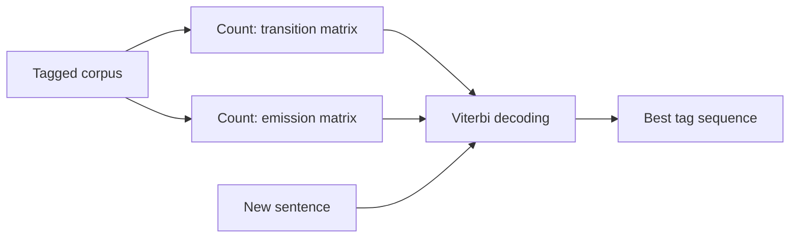

**In simple words:** an HMM guesses what is going on behind the scenes from what we can see. For POS tagging, the tags are hidden and the words are what we see, so the HMM finds the most likely tags for the words. <Cite id="class-nlp-pyq3" loc="p. 2" />

**Definition:** a Hidden Markov Model is a statistical model used to understand systems where the actual states are not directly visible, but we can see outcomes that depend on those hidden states. <Cite id="class-nlp-pyq3" loc="p. 2" />

**Everyday analogy:** you cannot look outside to see the weather, but you watch what people do (walk, shop, clean). Those actions give clues about the hidden weather.

**Components** <Cite id="class-nlp-pyq3" loc="p. 3" />

1. **States:** the hidden conditions (in POS tagging, the tags).
2. **Observations:** the signals we can see (the words).
3. **Transition probabilities:** how likely it is to move from one hidden state to another (tag to next tag).
4. **Emission probabilities:** how likely a state is to produce an observation (tag to word). In the example, when the weather is Rainy: walk 0.1, shop 0.4, clean 0.5.
5. **Initial state probabilities:** how likely the system is to start in each state.

**HMM for POS tagging:** the model is learned by counting in a tagged corpus. <Cite id="class-nlp-pyq3" loc="p. 7" />

$$
P(t_j \mid t_i) = \frac{\text{Count}(t_i \to t_j)}{\text{Count}(t_i)}, \qquad P(\text{word} \mid \text{tag}) = \frac{\text{Count}(\text{word}, \text{tag})}{\text{Count}(\text{tag})}
$$

Then the **Viterbi algorithm** finds the tag sequence with the highest probability: $\delta_t(j)$ is the best probability of any tag path that reaches tag $j$ at word $t$, with a back-pointer to the previous tag. At the end we follow the back-pointers to read the tags. <Cite id="class-nlp-pyq3" loc="p. 7" />

**Limitation:** it assumes the next tag depends only on the current tag, and cannot easily use extra clues. <Cite id="class-nlp-pyq3" loc="p. 5" />

**Conclusion:** an HMM tagger uses transition and emission probabilities, learned by counting, and Viterbi to pick the best tags.
