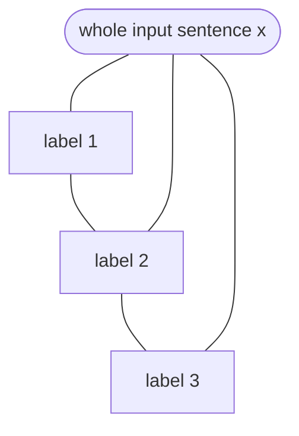

**In simple words:** Conditional Random Field (CRF) ek model hai jo sequence ke har item ko label deta hai (jaise har word ko POS tag), aur ye **poori label sequence ko ek saath score** karta hai, jo bhi clues hum chahein unhe use karke. <Cite id="hmm-maxent-crf-lafferty2001" /> <Cite id="hmm-maxent-crf-wiki-crf" />

**Kyun chahiye:** HMM "word -ing pe khatam hota hai" ya "next word *the* hai" jaise clues use nahi kar sakta aur unknown words pe struggle karta hai. MaxEnt tagger clues use karta hai lekin word by word decide karta hai, isliye usme **label bias** aata hai (wo future ko ignore kar sakta hai). CRF clues ki freedom rakhta hai aur label bias hata deta hai. <Cite id="hmm-maxent-crf-slp3-ch18" loc="§18.5" />

**Discriminative:** ye $P(\text{labels} \mid \text{words})$ ko directly model karta hai, ye nahi ki words kaise bane.

**Kaise kaam karta hai (linear-chain CRF):**

1. **Feature functions** define karo $f_k(y_{i-1}, y_i, x, i)$, har ek yes/no clue, jaise "word capitalised hai aur tag NNP hai", ya "previous tag DT hai aur tag NN hai".
2. Har feature ko **weight** $w_k$ do, jo tagged data se seekha jata hai. Bada positive weight matlab clue us tag ko support karta hai.
3. Label sequence ko score karo, saari positions pe weighted features jodke, phir **saari possible label sequences pe normalise** karo:

$$
P(y \mid x) = \frac{1}{Z(x)} \exp\Big(\sum_{i}\sum_k w_k f_k(y_{i-1}, y_i, x, i)\Big)
$$

Yahan $Z(x)$ wahi score hai har possible sequence pe jodke, taaki probabilities ka sum 1 ho.

4. **Train** karo sahi sequences ki likelihood maximise karke (gradient steps, $Z$ ke liye forward-backward algorithm).
5. **Decode** Viterbi algorithm se karo, best sequence ke liye.

<Cite id="hmm-maxent-crf-wiki-crf" loc="diagram" /> <Cite id="pos-tagging-gfg-crf" />

**Example:** "Will can spot Will" mein "capitalised aur first word nahi, tag NNP" jaise features dusre *Will* ko name ki taraf dhakelte hain, aur "previous tag modal hai, tag verb" *spot* ko verb ki taraf. CRF best poori sequence chunta hai.

| Point | HMM | MaxEnt (MEMM) | CRF |
|---|---|---|---|
| Type | Generative | Discriminative | Discriminative |
| Rich features | No | Yes | Yes |
| Normalised | Joint probability | Per word | Whole sequence |
| Label bias | No | Yes | No |

**Uses:** POS tagging, named entity recognition, chunking.

**Conclusion:** CRF poori label sequences ko weighted features se score karta hai, isliye rich clues use karta hai aur label bias se bachta hai, aur sequence labelling ka standard model hai.
