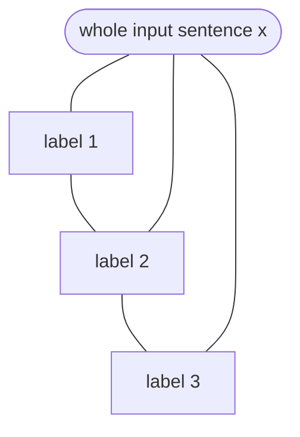

**In simple words:** a Conditional Random Field (CRF) is a model that gives a label to every item in a sequence (for example a POS tag to each word) by scoring the **whole label sequence at once**, using any clues we like. <Cite id="hmm-maxent-crf-lafferty2001" /> <Cite id="hmm-maxent-crf-wiki-crf" />

**Why it is needed:** an HMM cannot use clues such as "word ends in -ing" or "next word is *the*" and struggles with unknown words. A MaxEnt tagger uses clues but decides word by word, so it suffers from **label bias** (it can ignore the future). A CRF keeps the free use of clues and fixes label bias. <Cite id="hmm-maxent-crf-slp3-ch18" loc="§18.5" />

**Discriminative:** it models $P(\text{labels} \mid \text{words})$ directly, not how the words were produced.

**How it works (linear-chain CRF):**

1. Define **feature functions** $f_k(y_{i-1}, y_i, x, i)$, each a yes/no clue, for example "word is capitalised and tag is NNP", or "previous tag is DT and tag is NN".
2. Give each feature a **weight** $w_k$, learned from tagged data. A big positive weight means the clue supports the tag.
3. Score a label sequence by adding the weighted features over all positions, then **normalise over all possible label sequences**:

$$
P(y \mid x) = \frac{1}{Z(x)} \exp\Big(\sum_{i}\sum_k w_k f_k(y_{i-1}, y_i, x, i)\Big)
$$

Here $Z(x)$ is the sum of the same score over every possible sequence, so the probabilities add to 1.

4. **Train** by maximising the likelihood of the correct sequences (gradient steps, forward-backward algorithm for $Z$).
5. **Decode** with the Viterbi algorithm to get the best sequence.

<Cite id="hmm-maxent-crf-wiki-crf" loc="diagram" /> <Cite id="pos-tagging-gfg-crf" />

**Example:** in "Will can spot Will", features such as "capitalised and not first word, tag NNP" push the second *Will* to a name, and "previous tag is a modal, tag is verb" pushes *spot* to a verb. The CRF picks the best complete sequence.

| Point | HMM | MaxEnt (MEMM) | CRF |
|---|---|---|---|
| Type | Generative | Discriminative | Discriminative |
| Rich features | No | Yes | Yes |
| Normalised | Joint probability | Per word | Whole sequence |
| Label bias | No | Yes | No |

**Uses:** POS tagging, named entity recognition, chunking.

**Conclusion:** a CRF scores entire label sequences with weighted features, so it uses rich clues and avoids label bias, and it is a standard model for sequence labelling.
