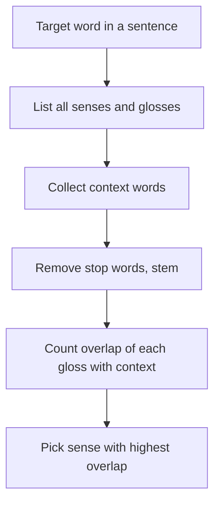

**In simple words:** bahut se words ke kai meanings (senses) hote hain. Lesk algorithm (Michael Lesk, 1986) wo sense chunta hai jiski dictionary definition (gloss) target word ke aas-paas ke words ke saath **sabse zyada words share** kare. <Cite id="word-sense-disambiguation-wiki-lesk" /> <Cite id="word-sense-disambiguation-gfg-wsd" />

**Idea:** sentence mein saath aaye words ek hi topic ki baat karte hain, isliye sahi sense ki definition padosi words ki definitions se overlap karni chahiye. Ye **knowledge-based** method hai: ise WordNet jaisi dictionary chahiye lekin training data nahi. <Cite id="word-sense-disambiguation-vcet-lesk" />

**Steps:**

1. Target word aur uske saare senses ko glosses ke saath list karo.
2. Context collect karo (sentence ke baaki words, ya un words ke glosses).
3. Stop words (*of, the, or, with...*) hatao aur words ko stem karo, taaki *tree* aur *trees* match ho.
4. Har sense ke liye context ke saath **overlapping words gino**.
5. Sabse zyada count wala sense chuno (tie ho to most frequent sense).

<Cite id="word-sense-disambiguation-vcet-lesk" loc="diagram" />

<Sum>

<Given>

Lesk ka apna example "pine cone". Glosses: pine#1 "kinds of evergreen tree with needle-shaped leaves"; pine#2 "waste away through sorrow or illness". cone#1 "solid body which narrows to a point"; cone#2 "something of this shape whether solid or hollow"; cone#3 "fruit of certain evergreen trees". Stop words ignore: of, with, to, which, or, this, whether, through, away, a.

</Given>

<Find>

*pine* aur *cone* ka best sense pair.

</Find>

<Steps>

1. Stemming ke baad content words: pine#1 \{kind, evergreen, tree, needle-shaped, leav\}; pine#2 \{wast, sorrow, illness\}; cone#1 \{solid, body, narrow, point\}; cone#2 \{someth, shape, solid, hollow\}; cone#3 \{fruit, certain, evergreen, tree\}.
2. 6 pairs mein se har ek ke shared words gino:

| | cone#1 | cone#2 | cone#3 |
|---|---|---|---|
| pine#1 | 0 | 0 | 2 (evergreen, tree) |
| pine#2 | 0 | 0 | 0 |

3. Sabse zyada overlap 2 hai.

</Steps>

<Answer>

pine#1 (ped) aur cone#3 (ped ka fruit), overlap = 2.

</Answer>

<Box kind="verify">

Winner dobara gino: "evergreen tree" pine#1 aur cone#3 dono mein hai (stemming ke baad *trees* *tree* se match karta hai), to 2. Baaki har pair mein koi content word share nahi hota, to 0. Meaning common sense se bhi fit hota hai: pine cone pine tree ka fruit hota hai.

</Box>

</Sum>

**Simplified Lesk** har gloss ko sentence ke words se directly compare karta hai, dusre glosses se nahi. NLTK mein `nltk.wsd.lesk` hai. <Cite id="word-sense-disambiguation-nltk-wsd" />

**Limits:** glosses chhote hote hain, isliye overlap aksar zero hota hai; ek common word galat match de sakta hai; ye dictionary ki quality pe depend karta hai.

**Conclusion:** Lesk wo sense chunta hai jiski definition context se sabse zyada overlap kare, ek simple method jise training data nahi chahiye.
