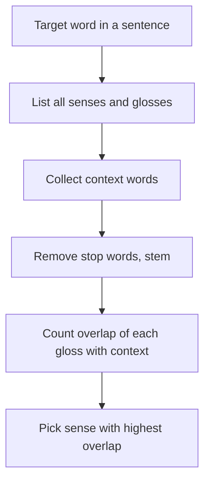

**In simple words:** many words have several meanings (senses). The Lesk algorithm (Michael Lesk, 1986) picks the sense whose dictionary definition (gloss) shares the **most words** with the words around the target word. <Cite id="word-sense-disambiguation-wiki-lesk" /> <Cite id="word-sense-disambiguation-gfg-wsd" />

**Idea:** words used together in a sentence talk about the same topic, so the right sense's definition should overlap with the neighbours' definitions. It is a **knowledge-based** method: it needs a dictionary such as WordNet but no training data. <Cite id="word-sense-disambiguation-vcet-lesk" />

**Steps:**

1. Take the target word and list all its senses with their glosses.
2. Collect the context (the other words in the sentence, or the glosses of those words).
3. Remove stop words (*of, the, or, with...*) and reduce words to stems so *tree* and *trees* match.
4. For each sense, **count the overlapping words** with the context.
5. Choose the sense with the highest count (break ties by the most frequent sense).

<Cite id="word-sense-disambiguation-vcet-lesk" loc="diagram" />

<Sum>

<Given>

Lesk's own example "pine cone". Glosses: pine#1 "kinds of evergreen tree with needle-shaped leaves"; pine#2 "waste away through sorrow or illness". cone#1 "solid body which narrows to a point"; cone#2 "something of this shape whether solid or hollow"; cone#3 "fruit of certain evergreen trees". Stop words ignored: of, with, to, which, or, this, whether, through, away, a.

</Given>

<Find>

the best sense pair for *pine* and *cone*.

</Find>

<Steps>

1. Content words after stemming: pine#1 \{kind, evergreen, tree, needle-shaped, leav\}; pine#2 \{wast, sorrow, illness\}; cone#1 \{solid, body, narrow, point\}; cone#2 \{someth, shape, solid, hollow\}; cone#3 \{fruit, certain, evergreen, tree\}.
2. Count shared words for each of the 6 pairs:

| | cone#1 | cone#2 | cone#3 |
|---|---|---|---|
| pine#1 | 0 | 0 | 2 (evergreen, tree) |
| pine#2 | 0 | 0 | 0 |

3. The highest overlap is 2.

</Steps>

<Answer>

pine#1 (the tree) and cone#3 (the fruit of the tree), overlap = 2.

</Answer>

<Box kind="verify">

Recount the winner: "evergreen tree" appears in both pine#1 and cone#3 (*trees* matches *tree* after stemming), so 2. Every other pair shares no content word, so 0. The meaning also fits common sense: a pine cone is the fruit of a pine tree.

</Box>

</Sum>

**Simplified Lesk** compares each gloss with the sentence words directly, not with other glosses. NLTK has `nltk.wsd.lesk`. <Cite id="word-sense-disambiguation-nltk-wsd" />

**Limits:** glosses are short, so overlap is often zero; a single common word can give a false match; it depends on dictionary quality.

**Conclusion:** Lesk chooses the sense whose definition overlaps most with the context, a simple method that needs no training data.
