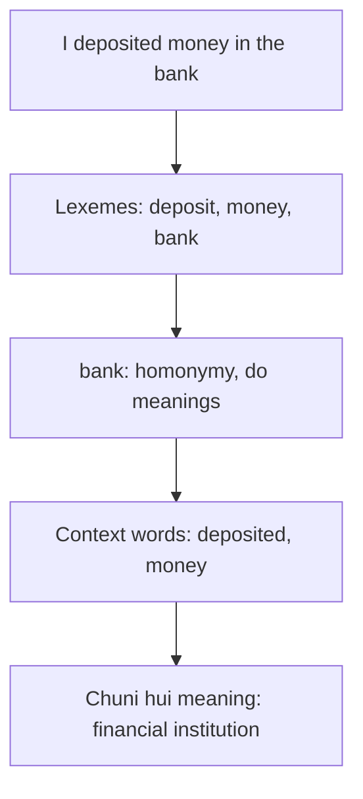

**In simple words:** lexical semantic analysis padhta hai ki har word ka kya matlab hai aur word meanings aapas mein kaise related hain. <Cite id="class-nlp-pyq4" loc="p. 9" />

**Lexeme aur lexicon:** lexeme ek single word ya phrase hai jiski specific meaning hoti hai aur jo kai contexts mein use ho sakta hai; word "cat" ek lexeme hai. Lexicon ek language ke saare lexemes ka poora collection hai, jaise English lexicon. Lexemes do main types ke hote hain: content words (cat, dog, house, tree) jinki specific meaning hoti hai, aur function words (the, of, and, to) jo content words ko jodte hain. Lexicon badalta rehta hai: naye lexemes judte hain aur purane use se bahar ho jaate hain (word "tweet" pehle chidiya ke chehchahane wala verb tha aur ab chhote message ke liye noun ban gaya). <Cite id="class-nlp-pyq4" loc="p. 9" />

**Lexemes ke beech relations:** <Cite id="class-nlp-pyq4" loc="p. 10" /> <Cite id="class-nlp-pyq4" loc="p. 11" /> synonymy (smart, intelligent), antonymy (hot, cold; alive, dead; buy, sell), hyponymy aur hypernymy (dog aur animal), meronymy (wheel aur car), polysemy (head) aur homonymy (bank).

**Lexical semantic analysis ka example:** "I deposited money in the bank."

1. **Lexemes dhundho:** I, deposited (deposit), money, in, the, bank. *Money* aur *bank* content words hain; *in* aur *the* function words.
2. **Lexicon mein meanings dekho:** *bank* ki do unrelated meanings hain (financial institution, nadi ka kinara), isliye ye homonymy hai. <Cite id="class-nlp-pyq4" loc="p. 2" />
3. **Context use karo:** *deposited* aur *money* financial institution ki taraf ishaara karte hain (ye word sense disambiguation hai, jaise Lesk's algorithm karta hai). <Cite id="class-nlp-pyq4" loc="p. 4" />

**Conclusion:** lexical semantic analysis lexemes dhundhta hai, lexicon mein unki meanings aur relations dekhta hai, aur context se sahi meaning chunta hai.
