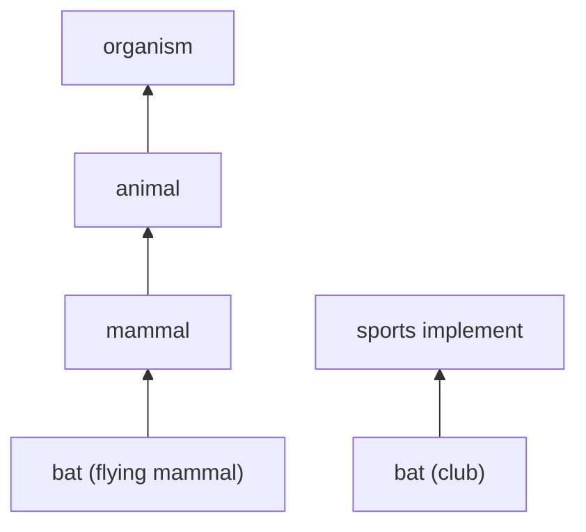

**In simple words:** lexical semantic analysis **akele words ke meaning** ko padhta hai aur ye ki words ek dusre se kaise related hain: same meaning, ulta meaning, ek dusre ke andar, ya ek word ke kai meanings. <Cite id="lexical-semantics-wiki-lexsem" /> <Cite id="lexical-semantics-slp3-appI" />

**Kyun chahiye:** computer ko sirf strings dikhti hain. Search, translate ya question answer karne ke liye use pata hona chahiye ki *car* aur *automobile* ka meaning same hai, aur *bank* ke do meanings hain.

**Words ke beech relations:**

| Relation | Meaning | Example |
|---|---|---|
| Synonymy | Same ya bahut close meaning | big, large |
| Antonymy | Ulta meaning | hot, cold |
| Hypernymy and hyponymy | General aur specific ("is a") | animal, dog ka hypernym hai |
| Meronymy | Part aur whole | wheel, car ka part hai |
| Polysemy and homonymy | Ek word, kai senses | bank, bat |

**Tool: WordNet.** Ye words ko **synsets** mein group karta hai (ek meaning wale synonyms ke sets) aur unhe in relations se jodta hai. <Cite id="lexical-semantics-gfg-synsets" /> <Cite id="lexical-semantics-nltk-wordnet-howto" />

**Worked example:** sentence "The bat flew out of the cave." ko analyse karo.

1. ***bat* ke senses dhoondho:** (a) udne wala mammal, (b) cricket ya baseball ka lakdi ka club.
2. **Context use karo:** *flew* aur *cave* mammal ke saath fit hote hain. Club cave se udke nahi nikalta.
3. **Sense (a) chuno** (ye step word sense disambiguation hai).
4. **Relations jodo:** bat (mammal), *mammal* ka hyponym hai, aur *mammal*, *animal* ka hyponym hai. To system ko pata hai ki sentence ek animal ke baare mein hai.

<Cite id="lexical-semantics-gfg-synsets" loc="diagram" />

**Uses:** word sense disambiguation, meaning pe based search (sirf words pe nahi), translation, question answering.

**Conclusion:** lexical semantic analysis har word ka sahi sense aur dusre words se uske relations dhoondhta hai, WordNet jaise resources ki madad se.
