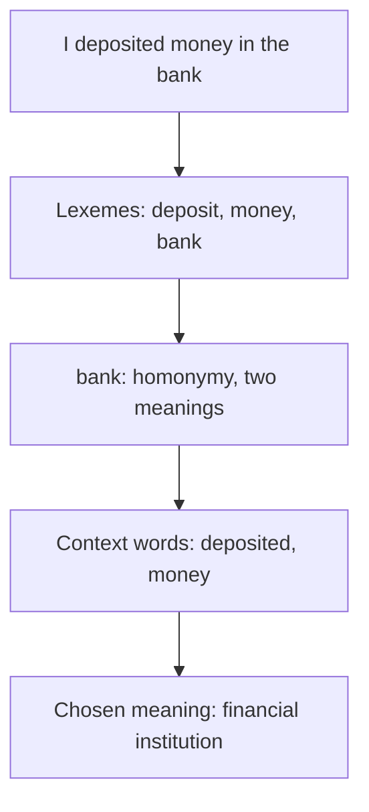

**In simple words:** lexical semantic analysis studies what each word means and how word meanings are related. <Cite id="class-nlp-pyq4" loc="p. 9" />

**Lexeme and lexicon:** a lexeme is a single word or phrase that has a specific meaning and can be used in a variety of contexts; the word "cat" is a lexeme. A lexicon is the entire collection of lexemes in a language, such as the English lexicon. Lexemes are of two main types: content words (cat, dog, house, tree), which have a specific meaning, and function words (the, of, and, to), which connect content words. The lexicon keeps changing: new lexemes are added and old ones fall out of use (the word "tweet" was a verb meaning to chirp and became a noun for a short message). <Cite id="class-nlp-pyq4" loc="p. 9" />

**Relations between lexemes:** <Cite id="class-nlp-pyq4" loc="p. 10" /> <Cite id="class-nlp-pyq4" loc="p. 11" /> synonymy (smart, intelligent), antonymy (hot, cold; alive, dead; buy, sell), hyponymy and hypernymy (dog and animal), meronymy (wheel and car), polysemy (head) and homonymy (bank).

**Example of lexical semantic analysis:** "I deposited money in the bank."

1. **Find the lexemes:** I, deposited (deposit), money, in, the, bank. *Money* and *bank* are content words; *in* and *the* are function words.
2. **Look up the meanings in the lexicon:** *bank* has two unrelated meanings (financial institution, river side), so it is homonymy. <Cite id="class-nlp-pyq4" loc="p. 2" />
3. **Use the context:** *deposited* and *money* point to the financial institution (this is word sense disambiguation, as Lesk's algorithm does). <Cite id="class-nlp-pyq4" loc="p. 4" />

**Conclusion:** lexical semantic analysis finds the lexemes, looks up their meanings and relations in the lexicon, and uses the context to choose the right meaning.
