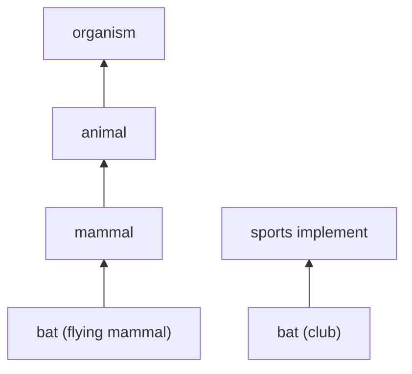

**In simple words:** lexical semantic analysis studies the meaning of **individual words** and how words relate to each other: same meaning, opposite meaning, one inside another, or several meanings for one word. <Cite id="lexical-semantics-wiki-lexsem" /> <Cite id="lexical-semantics-slp3-appI" />

**Why needed:** a computer sees only strings. To search, translate or answer questions it needs to know that *car* and *automobile* mean the same, and that *bank* has two meanings.

**Main relations between words:**

| Relation | Meaning | Example |
|---|---|---|
| Synonymy | Same or very close meaning | big, large |
| Antonymy | Opposite meaning | hot, cold |
| Hypernymy and hyponymy | General and specific ("is a") | animal is a hypernym of dog |
| Meronymy | Part and whole | wheel is a part of car |
| Polysemy and homonymy | One word, several senses | bank, bat |

**Tool: WordNet.** It groups words into **synsets** (sets of synonyms with one meaning) and links them by these relations. <Cite id="lexical-semantics-gfg-synsets" /> <Cite id="lexical-semantics-nltk-wordnet-howto" />

**Worked example:** analyse the sentence "The bat flew out of the cave."

1. **Find the senses of *bat*:** (a) a flying mammal, (b) a wooden club for cricket or baseball.
2. **Use the context:** *flew* and *cave* fit the mammal. A club does not fly out of a cave.
3. **Choose sense (a)** (this step is word sense disambiguation).
4. **Add relations:** bat (mammal) is a hyponym of *mammal*, which is a hyponym of *animal*. So the system knows the sentence is about an animal.

<Cite id="lexical-semantics-gfg-synsets" loc="diagram" />

**Uses:** word sense disambiguation, search that matches meaning (not only words), translation, question answering.

**Conclusion:** lexical semantic analysis finds the correct sense of each word and its relations to other words, using resources like WordNet.
