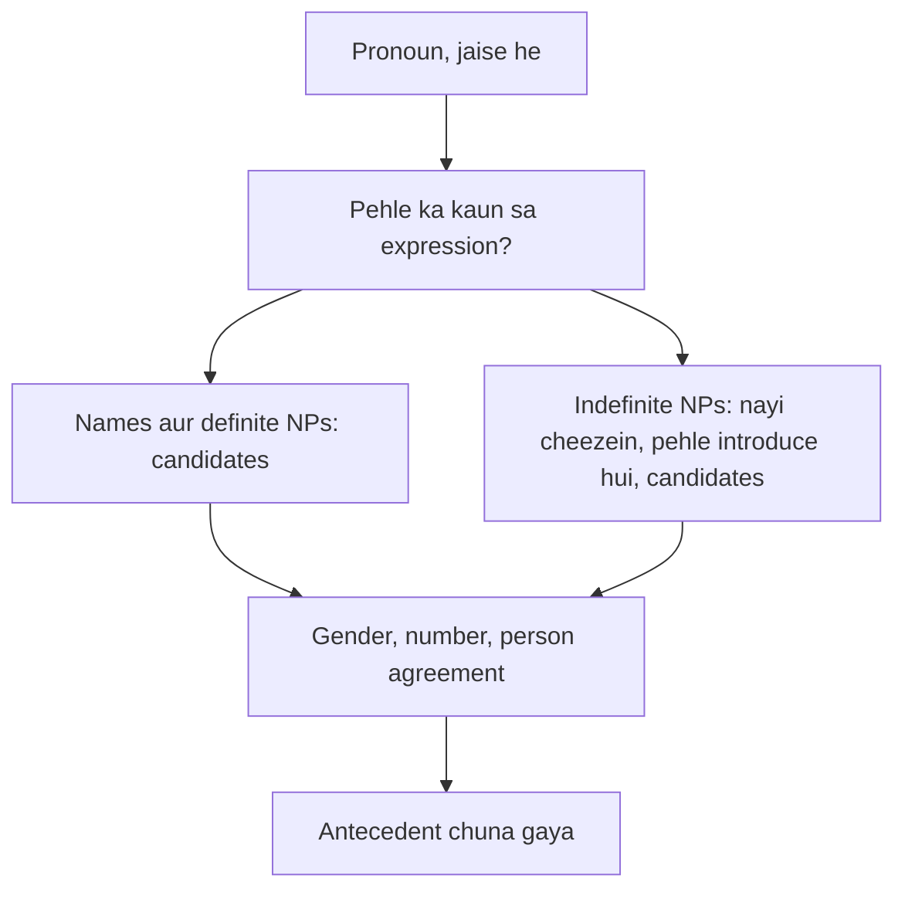

**In simple words:** *reference phenomena* wo alag-alag tareeke hain jinse text cheezon ko point karta hai. Pronoun problem solve karne ke liye system ko ye tareeke aur inki mushkilein pata honi chahiye. <Cite id="class-nlp-asol" loc="p. 4" />

**1. Referring expressions ke paanch types** (class answer). <Cite id="class-nlp-asol" loc="p. 4" />

| Type | Example |
|---|---|
| Indefinite NP (nayi cheez, a, an, some) | Ram had gone around one day to bring him **some food** |
| Definite NP (known cheez, the) | I used to read **The Times of India** |
| Pronoun (noun ki jagah) | Ram laughed as loud as **he** could |
| Demonstrative (this, that, these, those) | **This** is my book |
| Name (direct, context nahi chahiye) | **Ram**, India, Microsoft |

**2. Anaphora aur cataphora.** Anaphora peeche point karta hai (*Ram came. **He** sat.*); cataphora aage point karta hai (*When **he** came, Ram sat.*). Pronouns aam taur pe anaphors hote hain. *(Class files mein nahi.)*

**3. Wo cases jo resolution mushkil banate hain.** *(Class files mein nahi.)*

- **Inferrables:** referent ka naam nahi liya par guess ho sakta hai: "I bought a car. **The engine** is loud."
- **Discontinuous sets:** ek pronoun kai alag cheezon ko point karta hai: "Ram met Sita. **They** went home."
- **Generics:** pronoun ek poori kind ko mean karta hai: "I saw bears. **They** are dangerous."

**4. Agreement.** Pronoun ko antecedent se gender, number aur person mein agree karna chahiye, jaise *he* ke liye male singular noun.

**Conclusion:** paanch expression types, reference ki direction aur mushkil cases jaanne se system ko pata chalta hai ki har pronoun ke liye kahan dekhna hai aur kya check karna hai.
