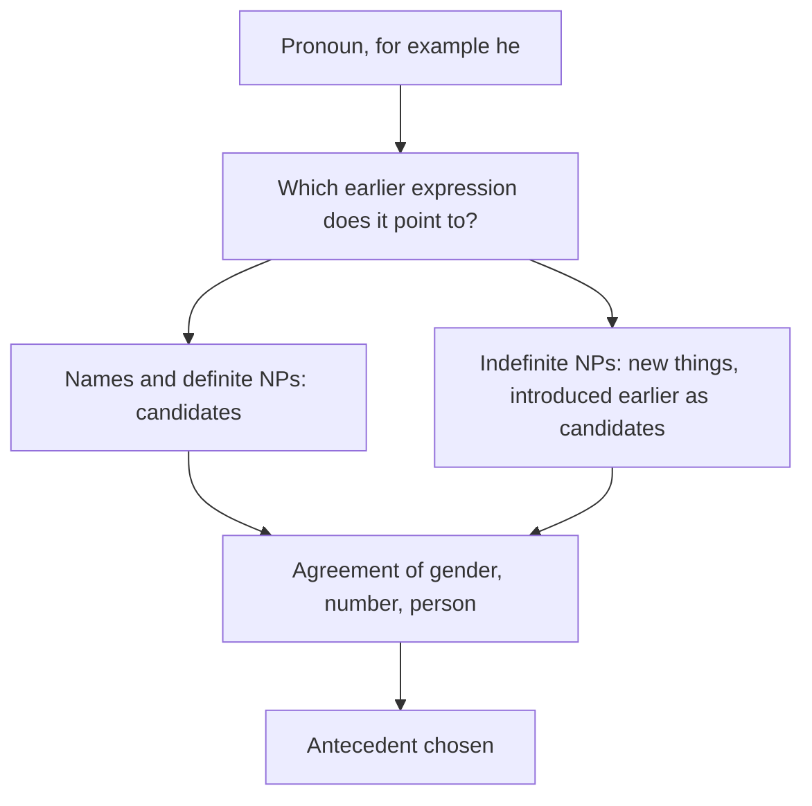

**In simple words:** the *reference phenomena* are the different ways a text points to things. To solve the pronoun problem, a system must know these ways and what makes them hard. <Cite id="class-nlp-asol" loc="p. 4" />

**1. The five types of referring expressions** (class answer). <Cite id="class-nlp-asol" loc="p. 4" />

| Type | Example |
|---|---|
| Indefinite NP (new thing, a, an, some) | Ram had gone around one day to bring him **some food** |
| Definite NP (known thing, the) | I used to read **The Times of India** |
| Pronoun (replaces a noun) | Ram laughed as loud as **he** could |
| Demonstrative (this, that, these, those) | **This** is my book |
| Name (direct, no context needed) | **Ram**, India, Microsoft |

**2. Anaphora and cataphora.** Anaphora points back (*Ram came. **He** sat.*); cataphora points forward (*When **he** came, Ram sat.*). Pronouns are the usual anaphors. *(Not in the class files.)*

**3. Cases that make resolution hard.** *(Not in the class files.)*

- **Inferrables:** the referent is not named but can be guessed: "I bought a car. **The engine** is loud."
- **Discontinuous sets:** one pronoun points to several separate things: "Ram met Sita. **They** went home."
- **Generics:** the pronoun means a whole kind: "I saw bears. **They** are dangerous."

**4. Agreement.** A pronoun must agree with its antecedent in gender, number and person, for example *he* needs a male singular noun.

**Conclusion:** knowing the five expression types, the direction of reference and the hard cases tells the system where to look and what to check for each pronoun.
